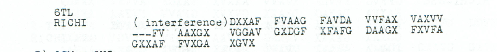

# p137 A6: conditional publicity fragments after interference

**ADFGVX Cipher — icekylinx and GPT-6 Astra Pro. Apache-2.0.**

The source preserves **74 coordinate slots: 71 valid symbols and three printed
dashes**, after an explicit interference annotation. A word-model search proposes
`DER OEFFENTLICHKEIT` and `BLEIBEN` in one leading-loss model. The primary edition
retains only these **25 conditional labels**, which preserve **15 observed halves**
and supply **35 absent halves**. No received coordinate changes, and all three
original dashes remain unknown. This is a sparse, language-guided proposal, not a
cipher-only recovery or a completed sentence.

The [case edition](../../cases/pages/137.md#edition-cases-military-p137-publicity-fragment) supplies readable
German and the distinct interpretation layer. [Inputs](inputs.json),
[certificates](certificates.json) and the [verifier](verify.py) retain the exact
source, modeled coordinate ownership and repair prices.

## Raw and edited layers

The representative model has **254 coordinate slots**, consisting of 180 inferred
leading unknown slots followed by the complete 74-slot source. The original
prints no total length. All 127 raw plaintext positions remain unresolved:

```text
???????????????????????????????????????????????????????????????????????????????????????????????????????????????????????????????
```

The primary assigns positions 13–30 and 45–51, leaving all fourteen intervening
positions 31–44 and 88 other positions unknown:

```text
?????????????DEROEFFENTLICHKEIT??????????????BLEIBEN???????????????????????????????????????????????????????????????????????????
```

There are **102 unassigned plaintext positions**, **145 still-unknown added
leading coordinates** and **three still-unknown printed masks**. Added leading
slots do not count as native ciphertext or printed damage. Every received valid
symbol is retained at its original source index.

| Proposed word | Plaintext positions, inclusive | Observed halves | Added fills | Wholly absent letters |
|---|---:|---:|---:|---:|
| `DER` | 13–15 | 2 | 4 | 1 |
| `OEFFENTLICHKEIT` | 16–30 | 9 | 21 | 6 |
| `BLEIBEN` | 45–51 | 4 | 10 | 3 |
| **Primary** | **25 positions** | **15** | **35** | **10** |

The wholly unobserved labels are **15 R, 17 E, 19 F, 22 T, 25 C, 26 H, 29 I,
46 L, 49 B and 51 N**. Both halves of each are supplied. Every other proposed
letter has exactly one observed half. Even the retained article and verb remain
language-guided choices within their domains.

## Adverse alternatives and equivalent frames

The discovery optimum contains the fluent 39-letter phrase
`DEROEFFENTLICHKEITNICHTVERBORGENBLEIBEN`. It is not the accepted primary. At the
same positions, `NICHT`, `IMMER` and `LANGE` each fit without changing a received
coordinate. Independently, `VERBORGEN` and `VERGOENNT` fit the same nine-letter
span. All **six combinations** assign 39 labels, preserve 23 observed halves,
supply 55 added coordinates and contain sixteen wholly unobserved labels.
They differ in polarity, duration and whether something remains hidden or
available/granted. The certificate prices each complete variant separately.

Both middle spans therefore remain unknown in the edition. These are examples,
not an exhaustive list of possible words. The local articles `DER`, `DEN` and
`DEM` also fit at equal coordinate price; `DIE` needs one observed-coordinate
change. The primary words are not claimed to be common to all possible readings.

| Model length | Added leading unknown slots | Primary labels | Unassigned positions |
|---|---:|---:|---:|
| 254 | 180 | 25/127 | 102 |
| 256 | 182 | 25/128 | 103 |
| 258 | 184 | 25/129 | 104 |

The **entire first 254 pretransposition half-coordinate source-owner indices are
identical** across these three models, as are all 127 received-pair domains.
The longer models merely append one or two entirely unobserved plaintext
positions. This is full-source projection equivalence, not just a tie for the
chosen phrase. The received fragment cannot establish which length was sent.
The certificate supplies an exact forward-encryption witness for each frame;
arbitrary remaining fills in those witnesses are proof devices, not readings.

A separate bounded test places the **narrow 25-label pattern**, with its fourteen
internal unknowns, at every offset in every even length from 74 through 1000.
It examines **106,953 placements**, of which **3,724** retain at least fifteen
observed halves. Only the three models above at offset 13 fit with zero changes;
no other placement at that threshold fits with only one change. This tests the
already-proposed pattern within a declared leading-loss family. It excludes
neither lower-support placements nor alternative wording, longer frames,
internal losses or trailing losses.

## Neighboring context and independent vocabulary

A separately priced `VON` at positions 124–126 needs four added fills and retains
two observed halves. Its first letter is wholly absent. It is excluded from the
primary output. The proposed following p129 A7 begins with the fully observed
`ALLGEMEINERHIERNICHTBEKANNTERPOLITISCHERLAGE`, which makes that connection
plausible. The [cross-page report assembly](../transylvania_situation_report/README.md)
remains conditional: the page dates and receipt times conflict, and semantic
continuity does not resolve those conflicts. Earlier A5 repairs and A7's
printed-mask fill retain their own separate costs.

`BLEIBEN` also occurs as the first seven wholly observed letters of independent
p163 A14 under the Nov7–9 key. Its fourteen native coordinates are checked here.
That is a vocabulary witness, not a copied clause or evidence for the missing
A6 length. No independent native copy of `OEFFENTLICHKEIT` or the complete
publicity clause has been found in the searched corpus.

## Exact-domain discovery and matched controls

The search reuses the [audited exact-domain word/bigram dynamic program](../p163_infrastructure_clause/domain_words.cpp)
and its [exhaustive small-domain oracle](../p163_infrastructure_clause/domain_words_oracle.py).
It branches over the full allowed letter domains and exactly maximizes the
specified finite lexicon/bigram objective. The word model has 53,465 words and
176,836 bigrams; its data provenance and regeneration instructions are pinned
in [the lexicon record](../p198_word_search/lexicon_provenance.json). The default
settings are fallback −3, bigram weight 0.65 and separator `X` score −0.25.
Exact optimization of that objective does not establish historical correctness.

[Discovery metadata](discovery.json) retains compact scores for **all 264 even
lengths 74–600 in every family**, plus each selected best completion. There are
3,432 retained scores across thirteen families: the received source, eight
shuffled sources, three different period keys and one fresh authored positive.
Shuffles preserve the 71-symbol multiset and printed-mask positions 25–27;
one fixed shuffle is used across every length in its family. The declared
shuffle seed is 1370418. Different-period-key controls use the registered ranks
and explicitly recorded representative square completions, filling unknown
cells with sorted unused symbols. They do not enumerate all key completions.

| Diagnostic family | Best full length | Best model score |
|---|---:|---:|
| `target` | 254 | -50.350566 |
| `shuffled_source_0` | 138 | -57.356859 |
| `shuffled_source_1` | 262 | -61.769746 |
| `shuffled_source_2` | 198 | -60.521669 |
| `shuffled_source_3` | 202 | -59.115058 |
| `shuffled_source_4` | 168 | -60.406336 |
| `shuffled_source_5` | 152 | -59.606740 |
| `shuffled_source_6` | 140 | -58.157470 |
| `shuffled_source_7` | 220 | -59.264128 |
| `wrong_key_Nov1-3` | 226 | -60.767179 |
| `wrong_key_Nov7-9` | 176 | -68.687478 |
| `wrong_key_Nov10-12` | 274 | -65.387389 |
| `authored_positive` | 254 | -54.802895 |

All eleven negative-control maxima are below the target maximum. This is a
bounded diagnostic comparison, not a uniqueness probability. The full model
completion contains unsupported and incoherent wording beyond the retained
fragment and is not accepted as a message.

The fresh positive control encrypts a newly authored 127-letter message about
an arriving detachment and examining a railway bridge. It contains neither
the publicity noun nor the proposed clause. Under the same 71-observation,
three-mask loss pattern and blind 264-length scan, its true length 254 ranks
first, yet the best output reproduces only **54 of 127 authored labels**.
Much of the remaining output is fluent invented wording. This adverse control
shows that correct frame ranking can coexist with severe lexical ambiguity.
The invented truth and selected output are retained for direct comparison.

## Source evidence

```text
DXXAF FVAAG FAVDA VVFAX VAXVV
---FV AAXGX VGGAV GXDGF XFAFG DAAGX FXVFA
GXXAF FVXGA XGVX
```

The literal source heading is `6TL`; `RICHI` has no length. The leading
`(interference)` annotation is preserved as metadata, not as a coordinate.
The three printed dashes occupy zero-based source positions 25–27.



The embedded crop comes from J. Rives Childs, *General Solution of the ADFGVX
Cipher System*, printed p137 / PDF p140: rectangle `[55, 430, 506, 478]` PDF
points, scale 4, 1804 × 192 RGB pixels. [Inputs](inputs.json) pin the hosted
original PDF URL, full-file byte count and SHA-256, crop PNG hash and decoded
RGB hash. Optional PDF verification checks the actual crop pixels against the
original scan. Without that PDF, verification reports that this comparison was
not performed; it still checks the embedded file and pixel hashes.

## Reproduce

Default verification needs no language-model download or C++ runtime:

```sh
python experiments/p137_publicity_fragment/verify.py --verify
```

To compare the crop to an existing original PDF:

```sh
python experiments/p137_publicity_fragment/verify.py --verify --pdf /path/to/childs.pdf
```

The verifier independently builds ragged columns, compares them with the cipher
module, preserves the full source-owner map, prices every supplied half, checks
all six adverse clauses and equivalent frames, reproduces the bounded sparse
pattern scan, verifies native context and checks the diagnostic snapshot's
family completeness and deterministic source generation. It verifies the
selected diagnostic outputs against their native letter domains but does not
recompute lexical scores by default.

Optional complete word-model replay, using the exact hash-pinned lexicon:

```sh
python experiments/p137_publicity_fragment/replay_discovery.py --lexicon /path/to/lexicon.txt
```

The complete replay recompiles the existing audited solver and recomputes all
3,432 frame scores. `--best-only` rechecks only thirteen retained winners;
`--family target` restricts a replay to one declared family. Winner-only replay
is a narrower check and does not itself validate optimization over all lengths.
The exact lexicon SHA-256 is
`6ea36fc166dd884a3a46f99aa7fd9ab03ae237d5a79c1a30f059e983d5f0d9ef`.

The period key and earlier cryptanalysis retain attribution to George Lasry,
Ingo Niebel, Nils Kopal and Arno Wacker. The source audit, conditional fragments,
semantic counterexamples and new controls are by **icekylinx and GPT-6 Astra Pro**.
