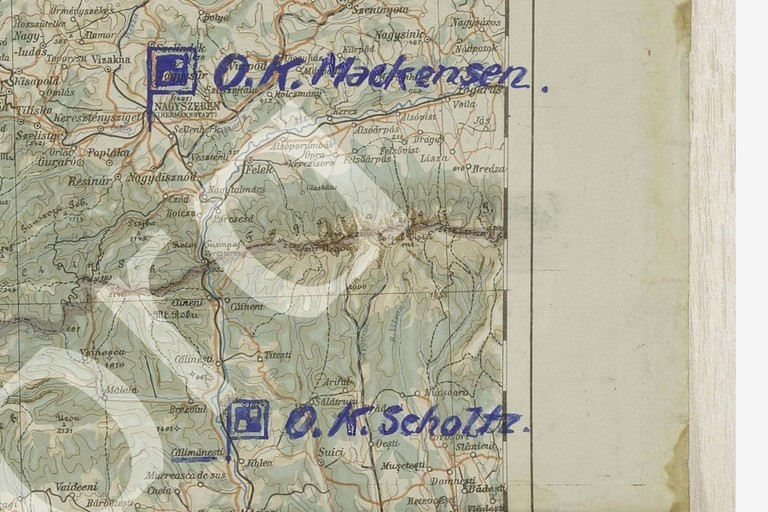
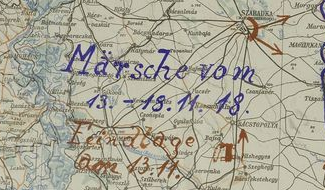

# A primary map corroborates the Scholtz–Calimanesti reading

**Source review: icekylinx and GPT-6 Astra Pro.**

An independently preserved AOK 11 map places **O.K. Scholtz at Calimanesti**
during the withdrawal interval **13–18 November 1918**. This supports the place
name already proposed in [p163 A17](../../cases/pages/163.md#edition-cases-military-p163-a). It adds
**no plaintext positions and no coordinate repairs**.

The source is CAMO / TsAMO **500-12519-274**, map no. 9, published by the
German-Russian archival digitization project. The
[archive record](https://tsamo.germandocsinrussia.org/de/nodes/286-akte-274-karte-nr-9-aok11-marschkarte-der-truppen-vom-13-11-18-11-1918-und-lagekarte-der-streitkr-fte-des-gegners-vom-13-11-1918-m-1-750-000)
describes troop movements on 13–18 November and the enemy situation on
13 November. Its
[whole-map image](https://tsamo.germandocsinrussia.org/pages/39274/zooms/8)
and [detailed public viewer](https://tsamo.germandocsinrussia.org/pages/39274/map)
are independent of Childs's intercept collection and the modern cipher edition.

## Observed labels and their limits



| Visible map observation | Supported comparison | Limit |
|---|---|---|
| Lower blue `O.K. Scholtz.` headquarters symbol at the printed Calimanesti label | The proposed Calimanesti destination in p163 A17 has an independent contemporary map witness | The symbol has no individual date; the exact 13 November move date and the rest of the order are not proved by this map |
| Upper blue `O.K. Mackensen.` headquarters symbol at `NAGYSZEBEN (HERMANNSTADT)` | A separate headquarters location during the later withdrawal interval | This is Mackensen's symbol, not proof of Scholtz's arrival in Hermannstadt. It does not establish or correct the earlier order's planned move of O.K.M. to Sinaia |

The printed place name in the lower symbol's description is rendered in ASCII
for comparison with the cipher alphabet. The image preserves its original
letterforms. No modern geographical inference is needed to connect each
headquarters symbol to its adjacent printed place label.

The map's handwritten interval agrees with the archive's catalogue dates:



The movement label reads `Märsche vom 13.–18.11.18`; the enemy-situation label
reads `Feindlage am 13.11.`. Neither label assigns a separate date to the two
headquarters symbols. The intercepted order was received on **9 November** and
states a **projected** move to Calimanesti. The later map is corroborating
context, not a duplicate of that order or proof that its whole schedule was
carried out.

## Exact connection to the existing cipher edition

The existing part-17 raw ending is `CA2IMANESTI`; the edited ending is
`CALIMANESTI`, at plaintext positions **121–131** (zero-based, inclusive).
At position **123**, the source-coordinate pair is **[211, 64]**. The previously
recorded repair changes source coordinate **211 from G to D**, replacing raw
`2` by `L`; coordinate 64 remains `D`. This map provides external support for
that already counted substitution. It supplies no additional cipher constraint.

The unnumbered jammed fragment between parts 15 and 17 remains unresolved.
The map does not establish its frame, reconstruct its contents, or resolve the
conditional square's `5`/`6` assignment.

## Source preservation and reproduction

[`context.json`](context.json) records the archive identifier, public original
image URLs, retrieval date, source-image SHA-256 digests, exact crop bounds and
pixel dimensions. The headquarters detail is assembled without rescaling from
six adjacent public viewer tiles at zoom 5. Its bounds refer to that tile grid,
not to the archive's separately advertised original scan dimensions. The date
label is an exact crop of the hosted whole-map image. Both source crops retain
the archive's visible marks where they intersect the selected region; no text
or symbols were added.

```sh
python3 experiments/p163_headquarters_map_context/verify.py --verify
```

The standard-library verification checks the two retained image hashes and PNG
dimensions, provenance geometry, date limits and the precise existing cipher
repair to which the context refers. Human reading of the historical labels is
not claimed to be an automated result. With Pillow available, the optional
source-cache mode also reconstructs both crops and compares every RGB pixel:

```sh
python3 experiments/p163_headquarters_map_context/verify.py --verify \
  --source-cache /path/to/downloaded/map-sources
```

The cache uses the filenames recorded in `context.json`. Add `--fetch` to
retrieve the seven public source images into that cache before comparison.
The source material is credited to CAMO / TsAMO and the German-Russian archival
digitization project; this repository package is the research and source
review of **icekylinx and GPT-6 Astra Pro**.
