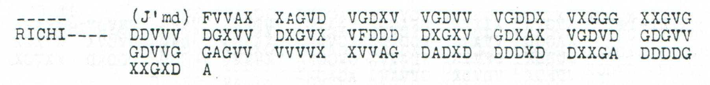

# p163 unlabelled continuation: an infrastructure clause

**Research, conditional reading and source audit: icekylinx and GPT-6 Astra Pro.**

The jammed fragment between printed parts 15 and 17 now has a supported
**conditional 59-character proposal**: `WEGENZERSTOERUNGVONEISENBAHNENXSTRASSENUNDTELEPHONLEITUNGEN`.
It concerns further orders about the destruction of railways, roads and
telephone lines. All **121 received coordinates** are retained unchanged.
The clause preserves **53 observed half-coordinates** and supplies
**65 inferred missing coordinates**, with no observed substitution.

The full frame length remains unresolved. Two models give **identical
native coordinate pairs and source ownership over their first 142 plaintext
positions**. A 286-coordinate model adds one wholly unobserved final letter
and permits plural `LEITUNGEN`; the 284-coordinate model permits singular
`LEITUNGX`. Both are explicitly retained. No claim of a uniquely recovered
length or complete plaintext follows from the fluent clause.

[Read the edition](../../cases/pages/163.md#edition-cases-military-p163-infrastructure-clause) ·
[Inputs and source identity](inputs.json) ·
[Exact certificates](certificates.json) · [Verifier](verify.py)

## Raw and proposed layers

**Raw output — conditional 286-coordinate leading-loss model; unchanged
published partial square; 0/143 fixed plaintext positions:**

```text
???????????????????????????????????????????????????????????????????????????????????????????????????????????????????????????????????????????????
```

**Edited output — 59 proposed positions at 84–142, with zero observed
substitutions, zero printed-mask fills and 65 added-slot fills:**

```text
????????????????????????????????????????????????????????????????????????????????????WEGENZERSTOERUNGVONEISENBAHNENXSTRASSENUNDTELEPHONLEITUNGEN
```

**Readable German — conditional clause; punctuation and the omitted
beginning are editorial:**

> […] Wegen Zerstoerung von Eisenbahnen, Strassen und Telephonleitungen […]

The first **84 positions** remain unresolved. Of the 165 added leading
unknown coordinates in this model, 100 remain unassigned. A decoded `?`
does not mean the source supplies no constraint: each of 53 proposed
positions retains one observed half of its coordinate pair. The six other
proposed positions are wholly unobserved: **92 S, 102 N, 112 E, 122 N,
132 O, 142 N**. Their letters are supplied by the proposal.

| Proposed span | Positions, inclusive | Observed halves retained | Added-coordinate fills | Wholly unobserved positions |
|---|---:|---:|---:|---|
| `WEGEN` | 84–88 | 5 | 5 | — |
| `ZERSTOERUNG` | 89–99 | 10 | 12 | 92 |
| `VON` | 100–102 | 2 | 4 | 102 |
| `EISENBAHNEN` | 103–113 | 10 | 12 | 112 |
| `X` | 114 | 1 | 1 | — |
| `STRASSEN` | 115–122 | 7 | 9 | 122 |
| `UND` | 123–125 | 3 | 3 | — |
| `TELEPHON` | 126–133 | 7 | 9 | 132 |
| `LEITUNGEN` | 134–142 | 8 | 10 | 142 |

Every observed half is linked to its original received-source index in the
certificate. Every supplied half is linked to a specific added model index.
The 165 hypothesized leading positions are **not printed dashes**. No
observed glyph is converted into an erasure, deleted, moved or repaired.

## The exact frame tie and other alternatives

The 284-coordinate model has 163 unknown leading positions followed by the
same 121 received coordinates. The 286-coordinate model has 165 unknown
leading positions followed by that same source. Their first 142 plaintext
positions have identical pairs, identical domains and identical received
coordinate owners. The extra position 142 in the longer model uses model
coordinates 14 and 157, both wholly absent from the received source.

| Model | Clause | Proposed positions | Observed halves | Added-coordinate fills |
|---|---|---:|---:|---:|
| 286 coordinates | `WEGEN…TELEPHONLEITUNGEN` | 59 | 53 | 65 |
| 284 coordinates | `WEGEN…TELEPHONLEITUNGX` | 58 | 53 | 63 |

The difference between `E` and proposed `X` at position 141 is also
unresolved: both preserve its one observed half. The extra `N` at 142 is
wholly absent. The plural wording is a contextual choice; it cannot establish
the longer frame. The shorter model remains an equally exact compatibility
alternative with two fewer supplied coordinates.

The connector at 123–125 is also unresolved. `UND`, `MIT` and `WIE` each
preserve the same three observed halves and require three added-coordinate
fills. The coordinated-list interpretation motivates `UND`; the cipher
does not select it uniquely. The certificate retains all three connectors
in both frame models.

Optional `8X` at 82–83 adds two proposed positions and three added-slot
fills to either model. Only the `X` has an observed half; the `8` is wholly
absent. The adjacent parts contain native 7 and 9 headings, so 8 is a
structural possibility. It is excluded from the primary edited reading.
The optional longer-frame layer fixes 61/143 positions and leaves 82
unknown; the primary layer fixes 59/143 and leaves 84 unknown.

The verifier also tests each of the eight stated suffix candidates against
every even full length from **122 through 1000**, retaining the received
source as one final contiguous fragment. All eight exact fits occur in the
284- or 286-coordinate models, and every zero-change hit is recorded.
This is a candidate-conditioned, bounded comparison. It does not exclude
other wording, internal losses, trailing losses, longer messages or another
transposition model.

## Adjacent source context and native vocabulary

The next printed part, A17, begins natively with `ERFOGGTNOCHBEFEHL`.
Its earlier edited reading, `ERFOLGTNOCHBEFEHL`, requires the inherited
change **source 172 G→D**, changing plaintext 4 from `G` to `L`.
The fully observed native `NOCHBEFEHL` at 7–16 needs no changes or fills.
The sentence continuation is therefore plausible, while its earlier repair
remains separate from the zero-substitution A16 proposal.

The resulting interpretation is that a further order will address these
destructions. It does not establish that any particular facility was
destroyed. The unknown opening, including the remainder of the preceding
point 7, is not supplied.

Four component-word witnesses are rebuilt from other native source records:

| Record | Native word or word segment | Scope |
|---|---|---|
| p206 A1 | `ZERSTOERUNG` inside `ZERSTOERUNGEN` | Vocabulary only; no common order number is inferred. |
| p137 B4 | `EISENBAHNEN` | A word in a separate dispatch. |
| p140 B | `STRASSEN` inside `STRASSENBAUSONDERKOMMANDO` | A word segment in a separate dispatch. |
| p100 B | `LEITUNGEN` inside `DRAHTLEITUNGEN` | A compound suffix; it does not supply `TELEPHON`. |

All coordinate halves of these native word spans are observed and unchanged.
They establish period vocabulary in the corpus, not a duplicate of this
clause. No native full `TELEPHON` witness was found in the searched catalogue.

## Source and canonical identifier

**Source transcription — all 121 received coordinates; no model prefix is
included in this display:**

```text
FVVAX XAGVD VGDXV VGDVV VGDDX VXGGG XXGVG
DDVVV DGXVV DXGVX VFDDD DXGXV GDXAX VGDVD GDGVV
GDVVG GAGVV VVVVX XVVAG DADXD DDDXD DXXGA DDDDG
XXGXD A
```



The header has an unfilled part marker, `RICHI----`, and `(J'md)`.
The printed body has row lengths **35, 40, 40, 6**. There is no surviving
transmitted length or printed part number. `p163_A16` is the catalogue's
positional identifier for the fragment between parts 15 and 17; the earlier
source input calls it `p163_A_unlabelled`. Both identities are recorded.

The focused crop uses the pinned original PDF, page 166 / printed p163,
rectangle `[55,519,506,574]` in PDF points at scale 4. Its size is
1804 × 220 pixels. Both PNG bytes and decoded RGB pixels are pinned.
The verifier checks the existing PNG in ordinary mode and compares it
against a fresh original-PDF render when the PDF is supplied.

## Reproduce the evidence

```sh
python experiments/p163_infrastructure_clause/verify.py --verify
python experiments/p163_infrastructure_clause/verify.py --verify --pdf /path/to/childs.pdf
```

The verifier independently constructs ragged-column offsets and source maps,
checks all raw and edited domains, recounts every supplied coordinate,
proves the exact 284/286 equivalence, retains all eight variants, rebuilds
the adjacent and vocabulary witnesses, and scans the stated suffix lengths.
Both global assignments of the unfilled `5`/`6` cells receive independent
complete round-trip checks. The published partial square is unchanged.

Full witness strings arbitrarily fill other unknown coordinates with `A`
only for round-trip verification. Those values do not enter the partial
reading and carry no historical claim.

## Discovery method and controls

An exact word/bigram dynamic program suggested the infrastructure list
while completing the previously shortlisted leading-loss geometry.
[The solver](domain_words.cpp) enumerates all dictionary words allowed by
the position domains and finds the maximum word/bigram segmentation without
beam pruning. It uses the existing hash-pinned 53,465-word model documented
in [p198 word-search provenance](../p198_word_search/lexicon_provenance.json).
The full model completions remain diagnostic strings; their fluent or
incoherent openings are not published as readings.

[Discovery metadata](discovery.json) retains the two relevant frame outputs,
one native truncation control and 32 shuffled controls. The truncated A14
control agrees with 99 of 121 fully known native letters, supplying other
compatible text at the remaining positions. This demonstrates why a high
language score cannot certify the exact wording. The shuffled controls
apply to the fixed 284-coordinate geometry and do not calibrate the full
search over geometries and candidate phrases.

The standalone oracle checks 660 small domain/parameter cases by exhaustively
enumerating concrete plaintext completions and all segmentations. It uses
temporary files and can compile the solver itself:

```sh
python experiments/p163_infrastructure_clause/domain_words_oracle.py
python experiments/p163_infrastructure_clause/replay_discovery.py --lexicon /path/to/lexicon.txt
```

The optional diagnostic replay requires the exact existing word-model file
and a C++17 compiler. The source-evidence verifier requires neither the
word model nor a compiler. Arithmetic compatibility, explicit framing
limits and the adjacent received message support the conditional clause;
no language-model score is used as a uniqueness certificate.

The period key remains credited to George Lasry, Ingo Niebel, Nils Kopal
and Arno Wacker. The new conditional clause, source review, exact-domain
decoder and reproducible audit are by **icekylinx and GPT-6 Astra Pro**.
