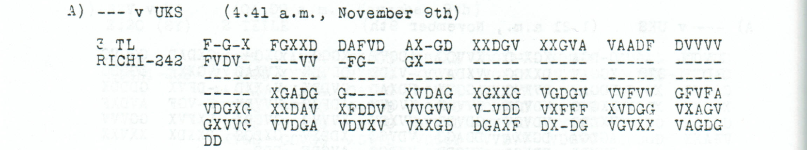

# p164 A3: the occupation-army fragment

**Source review and reconstruction: icekylinx and GPT-6 Astra Pro.**

**BESATZUNGSHEER** is a new, source-compatible reading of positions 18–31
in the original p164a challenge. The 14-letter word agrees with **all 18
observed coordinate halves** in that span. Four letters were already fixed;
the other ten each retain one received half and need one printed-mask fill.
**No observed coordinate changes.**

Two different-key messages independently contain the word in their native
raw output: p66 B under Oct4–6 and p115 A8 under Nov1–3. This supports a
readable alternative to the earlier `BEFRIEDNISXE??` proposal. It does not
identify the two donor messages as copies of p164.

## Reviewed source and new reading



The inherited p164 source model has **242 slots, 158 observed coordinates
and 84 masks**. It explicitly expands the short erased groups to the
printed five-slot layout; those existing source-layout assumptions remain.
The received `V` at source 49 is visibly retained in the literal source.

**Edited output — new word only, 52/121 fixed positions, ten mask fills:**

```text
???X?X?1?T???E?A?XBESATZUNGSHEER???V?P?T??FN?X?N?M??1??R???D??V??X?I?C??A1?W?S?E??NF?U?D????G??E?D???????O?G???????S?T???
```

**Readable German — excerpt of the new word layer:**

> […] Besatzungsheer […]

**Meaning:** The fragment names an occupation army. The surrounding unit or
reference fields remain unread.

## Independent native witnesses

| Source | Key | Directly observed span | Role |
| --- | --- | --- | --- |
| [p66 B](../october_staffing/sources/childs_p66_B.png) | Oct4–6 | `BESATZUNGSHEER` | Independent vocabulary |
| [p115 A8](../mackensen_withdrawal_report/sources/p115.png) | Nov1–3 | `BESATZUNGSHEER` | Independent vocabulary |
| [p153 A3](../nov7_danube_and_message_reports/sources/p153_reviewed.png) | Nov7–9 | `QX9X11XTEMESVARX` | Date/place parallel |

Every donor letter is decoded again from its two original observed
coordinates. The date/place witness supports **Norbert's existing comment
47 proposal**, `???X9X11XTEMESVARX`, at the beginning of p164 A3. The target
requires one explicit source-49 `V→X` change for the S of TEMESVAR. Its
initial three positions are not filled from the donor's headquarters label.

## Revised conditional edition

Combining the new word, the earlier date/place proposal and the remaining
Norbert comment 42 clauses gives **104/121 fixed positions**, with **four
observed substitutions and 66 mask fills**. The former 101-position proposal
needed five substitutions and 63 fills. The date field agrees with the raw
1 at position 7, so the earlier source-12 `F→X` substitution is unnecessary.

**Edited output — revised combined proposal; the other earlier clauses remain conjectural:**

```text
???X9X11XTEMESVARXBESATZUNGSHEER???V?P?T??FN?XUNDM??1??R??XDIEVONXMIRCONACHWESTENUNDSUEDENWEGXLEIDERWEGEVOMGEGNERBESETZTX
```

The inherited `MIRCO` label, `LEIDERWEGE` wording and intervening unknowns
remain literal. This is a stronger partial edition, with no complete
sentence or geographic identification inferred. The separate date-plus-word
layer fixes 60/121 positions using only one observed change and 20 mask
fills, without importing those earlier clauses.

Position 32 is wholly unobserved. The two donor continuations supply
different next letters, so neither is adopted. Position 33 retains the
global 5/6 square ambiguity. Both complete square assignments are checked.

## Search and verification

The reproducible search used **488 unique raw streams, 52,034 positions**,
excluding this target's own readings. It found the word at position 18 with
18 matching observed halves. The longest tied donor spans extend one
letter into wholly absent position 32; the edition deliberately stops at
the supported 14-letter word.

In 500 deterministic shuffles of the observed source coordinates, with all
masks held fixed, no donor match reached the 12-character search threshold.
Three freshly planted long words were retrieved at the correct position;
the ten-character control was below the threshold and returned no hit.
These are method checks, not a probability or uniqueness claim for the
historical wording.

```sh
python experiments/p164_occupation_fragment/verify.py --verify
python experiments/p164_occupation_fragment/verify.py --verify --pdf /path/to/childs.pdf
python experiments/p164_occupation_fragment/replay_search.py
```

The core check uses standard-library Python. Search replay additionally
uses NumPy; optional original-PDF pixel reproduction uses PyMuPDF.
[Inputs](inputs.json), [coordinate certificates](certificates.json),
[frozen donor manifest](donor_manifest.json) and [search controls](search_report.json)
retain the full evidence. Residual round-trip fills are arithmetic witnesses.

**Earlier credit:** J. Rives Childs supplies the historical source; George
Lasry and colleagues supply the period keys. Norbert's 2017 comments 42
and 47 retain the route clauses and date proposal. The new word retrieval,
cross-key evidence and revised repair account are the present contribution.
