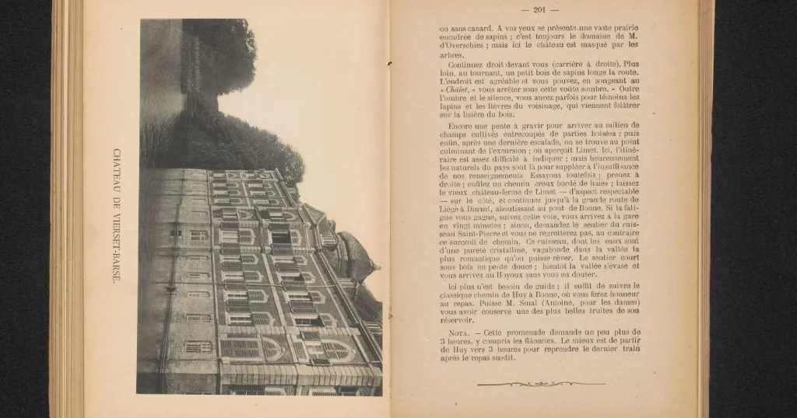

# p183 F — Vierset-Barse in the accommodation list

**Research and editorial work: icekylinx and GPT-6 Astra Pro.**

The [Jaeger accommodation report](../../cases/pages/183.md#edition-cases-military-jaeger-accommodation-area)
contains `VIERSWT X BARSE`. We propose **VIERSET X BARSE**, identifying the two
fields with **Vierset-Barse**. This corrects one word at **one additional observed
coordinate substitution**, with no new mask fill or fixed plaintext position.

## Independent printed spelling

The Rijksmuseum holds a collotype plate from *Huy-pittoresque : guide de
l'excursionniste*, opposite page 201. Its printed caption reads
**CHATEAU DE VIERSET-BARSE**. The museum dates the item to about 1885–1890 and
attributes the photograph to Victor Gaillard and the collotype to Emile Aubry.



[Rijksmuseum permanent record](https://id.rijksmuseum.nl/200711112),
object **RP-F-2001-7-1173-29**. The museum marks the image public domain.
The saved image is the unaltered institutional IIIF response; its URL and
SHA-256 digest are recorded in [inputs.json](inputs.json).

The caption establishes the spelling. Identifying the adjacent message fields
with that place is our editorial inference from the name and the Huy context.
It does not establish the division's precise boundaries or supply another
word in the report.

## Exact cost

| Field | Received | Proposal |
| --- | --- | --- |
| Plaintext positions 83–89 | `VIERSWT` | `VIERSET` |
| Plaintext position 88 | W | E |
| Pair from original source positions 126, 170 | `VD` | `VX` |
| Source position 170 | D | X |

All indices are zero-based. The printed D at source 170 is clear in the
[original source excerpt](../jaeger_accommodation_area/sources/p183_reviewed.png).
This is a priced text correction, not a transcription change.

The existing 230-coordinate frame, JAEGER repair at source 180 and dash fills
at 182–183 are retained. Total cost becomes **two observed substitutions and
two source-mask fills**. The published-square reading remains **112/115**;
the three coupled numeral positions remain at 8, 62 and 109. The numeral
interpretation in the separate [joint reconstruction](../nov10_joint_completion/README.md)
can be combined with this independent word correction.

```sh
python experiments/p183_vierset_place/verify.py --verify
python experiments/jaeger_accommodation_area/verify.py --verify
```

The check reconstructs the pair origins, exact source differences, complete
new stream and remaining domains. All **120** completions of the published
partial square re-encrypt to the same corrected ciphertext. The
[certificate](certificate.json) records the resulting text and costs.
