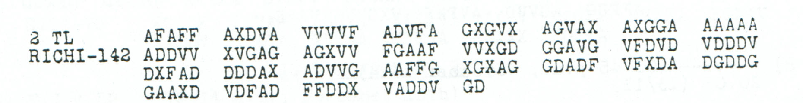

# p187b: one adjacent swap explains two word corrections

[ADFGVX Cipher](../../README.md) · [Case and earlier readings](../../cases/pages/187.md#edition-cases-p187b) · [Experiment index](../README.md)

**icekylinx and GPT-6 Astra Pro · 2 November 2026**

The printed group **`VDFAD` → `VDFDA`** simultaneously changes `NITHT` to
`NICHT` and `ARBEICET` to `ARBEITET`, under the already published `CHI-Nov13`
key. This is one adjacent transposition of two received coordinates, with
the other **140 of 142 coordinates unchanged**. The coordinate histogram,
message length, transposition key and partial square remain the same.

**The words are not a new decipherment.** Norbert already normalized them
in [comment 53, 3 May 2017](https://scienceblogs.de/klausis-krypto-kolumne/2017/02/23/the-top-50-unsolved-encrypted-messages-46-unsolved-adfgvx-cryptograms-from-world-war-1/?all=1#comment-878079).
This audit supplies their exact coordinate mechanism. It does not establish
where the historical error arose, and it retains the printed `AD` as the
received evidence.

## Source and exact changes

The source is printed p187, PDF page 190, section A2 / second part, headed
`RICHI-142`. Group 26 reads `VDFAD`; its last two letters are received
positions **129–130 when counted from one** (indices **128–129 from zero**).



| Plaintext position, zero-based | Raw pair and letter | Pair and letter after the swap | Received pair indices, zero-based |
|---|---|---|---|
| 27 | `AG` → `T` | `DG` → `C` | 128, 65 |
| 35 | `DG` → `C` | `AG` → `T` | 129, 66 |

The two changed coordinates supply the first halves of the two affected
digraphs. Their second halves are both `G`. The known cells already fix
`AG = T` and `DG = C`; none of the fourteen unknown cells participates.

### Raw reading

```text
SOWEITFERNSCHREIBERVERBDGNITHTARBEICETXRESTSCHRIFTLICHXNACHCHEF?X??????
```

### Conditional reading after this one swap

```text
SOWEITFERNSCHREIBERVERBDGNICHTARBEITETXRESTSCHRIFTLICHXNACHCHEF?X??????
```

Both layers fix **64 of 71 plaintext positions**. All seven unresolved
positions remain unresolved; the repair improves two already fixed but
garbled letters. Counting coordinate substitutions separately, its cost is
exactly two. The full stated text cannot be obtained with just one such
substitution because its two affected digraphs use distinct source positions.

## Exhaustive check and limits

The verifier tries all **141 single adjacent swaps** in the 142-coordinate
source. Exactly one produces the entire conditional partial reading above:
indices 128 and 129. This is uniqueness within that declared operation and
fixed-key scope, not a claim that no other historical explanation is possible.

It also checks the source-to-plaintext maps, unchanged coordinates, equal
histograms, unresolved-position set and exact re-encryption of both layers.
A complete square is constructed solely for the mechanical roundtrip;
its arbitrary labels are never accepted as historical values. Since the two
affected cells are already attested, every injective completion leaves this
repair unchanged.

```sh
python3 experiments/p187b_adjacent_swap/audit.py --verify
```

The complete evidence is in [result.json](result.json). An
[independent review](../../data/reviews/p187b_adjacent_swap_independent.json)
uses separate column-offset arithmetic, a roundtrip through numeric square
cells and direct inspection of the source crop and earlier comments. The
source transcript and published key remain in their original conservative
layers.
