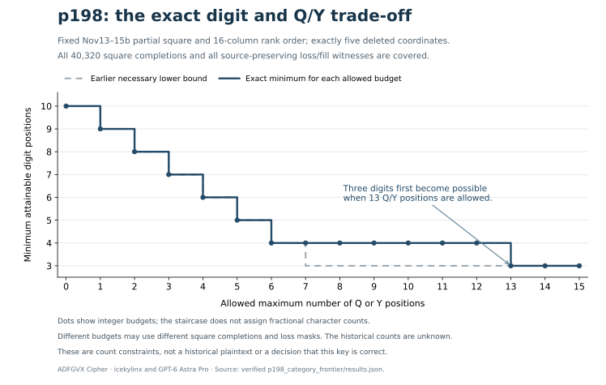

# Exact digit and Q/Y trade-off for a partial key

**ADFGVX Cipher · icekylinx and GPT-6 Astra Pro · 2026**

## Result

Under the recorded Nov13-15b partial square and transposition, an
85-position p198 reading containing only **three digits must contain at
least 13 occurrences of Q or Y**. Four digits permit six Q/Y positions;
a reading with neither Q nor Y requires at least ten digits. Each of
these minima has an explicit source-preserving witness.

The exact nondominated count pairs are:

| Digit positions | Q or Y positions | Other 24 ordinary letters |
| ---: | ---: | ---: |
| 3 | 13 | 69 |
| 4 | 6 | 75 |
| 5 | 5 | 75 |
| 6 | 4 | 75 |
| 7 | 3 | 75 |
| 8 | 2 | 75 |
| 9 | 1 | 75 |
| 10 | 0 | 75 |

This **Pareto frontier** minimizes the two counts simultaneously. A count
pair is omitted when another attainable pair has no more digits and no
more Q/Y positions, with at least one count strictly smaller. The table
does not list every attainable count pair, and it does not rank the texts
by linguistic plausibility.

The historical counts are unknown. These are constraints on future
plaintext proposals under one declared key/damage family, not a rejection
of that family or a decipherment. No language model or p-value is used,
and no historical plaintext is accepted.

## The exact scope

The search covers:

- All **8! = 40,320** complete extensions of the recorded partial square.
- Its fixed **16-column Nov13-15b transposition**.
- All **C(170,5) = 1,115,034,284** ways to delete exactly five coordinates
  from a 170-coordinate ciphertext.
- Every filling of those five coordinates with `ADFGVX`.
- All **165 observed coordinates**, preserved unchanged and in order.

The eight unknown square cells contain `Q`, `Y`, `2`, `3`, `4`, `7`, `8`,
`9`. There are 28 choices of which two cells hold Q/Y. Within each choice,
the `2!` Q/Y permutations and `6!` digit permutations leave both count
objectives unchanged. A single complete representative per membership
therefore covers all its 1,440 label permutations. Membership is fixed
per cell for the entire message.

Every one of the **28 membership classes** completes all **15,504 column
loss allocations**. The report stores 108 per-membership frontier witness
records and eight global frontier witness records. Each witness uses one
globally consistent complete square and one loss geometry. Different
frontier points may use different square completions; their assumptions
must not be combined as though they were one fixed historical key.



Dots represent integer Q/Y budgets. The staircase is a visual guide, not a
fractional character count. The plateau shows why the earlier scalar bounds
missed the stronger restriction between seven and twelve allowed Q/Y positions.

Other keys, transpositions and types of transmission damage remain
outside this result. Inputs and frozen source provenance are in
[inputs.json](../p198_exact_sparse/inputs.json).

## What this adds to the scalar bounds

The earlier [ordinary-letter bounds](../p198_letter_bounds/README.md)
proved that every reading in the family has at least three digits. The
[24-letter category audit](../p198_letter_bounds/CATEGORY_BOUNDS.md)
proved that digits plus Q/Y occupy at least ten positions.

Those separate inequalities allow the hypothetical pair `(3 digits,
7 Q/Y)`. The exact frontier rules it out: at three digits, the minimum
Q/Y count is **13**. The three-digit extreme is therefore much more
restrictive than the separate bounds suggested. With at most six Q/Y
positions, at least four digits are required; with no Q/Y, the exact
minimum is ten digits.

This conclusion concerns counts only. It does not assume that Q or Y is
absent, impose a historical digit limit, or equate an alphabet-rich text
with readable German.

## Concrete witnesses

The `(3,13)` frontier point uses Q/Y cells `16,35`, zero-based in the
row-major square. One recorded representative inserts `AFFAA` at
ciphertext positions `66,89,101,107,167`.

The `(10,0)` point uses Q/Y cells `1,2` and inserts `AAFAA` at positions
`64,71,101,107,125`. Its loss mask differs from the separately recorded
scalar-category witness because this algorithm uses a different
deterministic witness-selection order. Both reproduce the source and
attain the same count pair.

[results.json](results.json) contains the representative square, complete
plaintext, completed ciphertext, loss positions, fill values and category
counts for every frontier witness. The texts are feasibility witnesses,
not proposed historical plaintexts. The selection rule retains the first
encountered witness under documented deterministic enumeration; it makes
no claim of globally lexical-canonical tie order.

## Exact adjacent-column-pair dynamic programming

Fix one membership assignment and one allocation of the five losses
among the physical columns. This fixes the received source segment in
each column. Since the transposition width and coordinate length are
even, each plaintext pair always joins two adjacent physical columns,
and those two columns have the same full height.

For a particular adjacent pair, a small insertion-alignment dynamic
program walks the rows. Its state stores the numbers of losses used in
the left and right columns. For every state it retains a set of
nondominated `(digits, Q/Y)` count vectors together with concrete loss
and fill witnesses.

At a missing coordinate, all allowed values are considered by category.
A completion producing one of the other 24 letters contributes `(0,0)`
and dominates a digit or Q/Y completion at that same local state. If no
such completion exists, digit and Q/Y alternatives may remain incomparable
and must both be retained. This is the essential change from maximizing
a single scalar count.

Dominance is exact: two prefixes in the same row/used-loss state have
identical future source choices, and adding the same future count vector
preserves componentwise dominance. Different physical column pairs are
independent once the loss allocation is fixed. Their attainable vectors
are combined by pairwise sums, with dominated sums removed. A union over
all loss allocations and all membership assignments gives the global
frontier.

Repeated source-segment pairs are cached. Each historical membership
needs only **903 distinct pair subproblems**, although all 15,504 allocations
are covered. The largest frontier within a pair state is three vectors.
This factorization uses Python's standard library and requires no C++
compiler, external model, or approximate beam search.

## Controls that exercise incomparable states

The short controls exhaust widths 4, 6 and 16, one or two losses, and all
28 membership assignments. Independent enumeration covers **285,264
membership/loss/fill witnesses** and compares the complete frontier for
each setting, not only a single maximum.

A targeted six-character fixture ensures the algorithm actually retains
incomparable alternatives. With ranks `3,1,4,2`, the first representative
square and observed ciphertext `DFFDDAADDAA`, all 72 one-loss/fill
witnesses have frontier:

\[
\{(1,4),(2,2)\}.
\]

Neither point dominates the other. Concrete examples are `Q5YQFQ`, with
one digit and four Q/Y positions, and `J1YQ5H`, with two digits and two Q/Y
positions. This fixture was added after independent review observed that
the initial controls had only singleton frontiers. It checks the vector
state behavior rather than merely repeating a scalar-count test.

Every full reported witness is independently decrypted, counted,
re-encrypted and reduced to the original received source. A separate
implementation recomputes the frontiers using its own pair-state layout
and cipher arithmetic, without importing the primary optimizer or the
repository cipher module.

## Reproduce and verify

To rerun every primary control, all memberships and allocations, and
compare all witnesses with the committed report:

```sh
python3 experiments/p198_category_frontier/compute.py --verify
```

Omit `--verify` to regenerate the report. `--pilot-allocations 100` runs
an explicitly incomplete timing pilot and writes no global result.

For a fast check of the recorded source witnesses, membership coverage,
frontier arithmetic and hashes:

```sh
python3 experiments/p198_category_frontier/verify_recorded.py
```

That command does not recompute the optimizer. For a separate exact
implementation that does exhaust the finite scope, including all small
controls and the targeted incomparable fixture:

```sh
python3 experiments/p198_category_frontier/verify_independent.py --verify
```

The independent command provides computational corroboration of the
complete frontier. The historical interpretation remains conditional on
the same partial square, ranks and five-deletion model.

Its complete scope and hashes are retained in the
[independent review](../../data/reviews/p198_pareto_independent.json).
The optional [plotting script](plot_frontier.py) renders the committed
count table; Matplotlib is needed only to regenerate the illustration,
not for either exact solver or the verification workflow.
