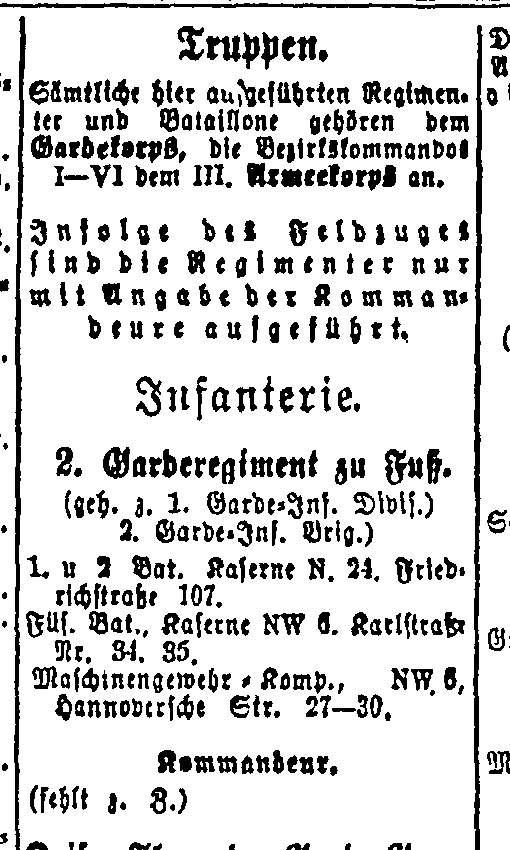

# The Berlin unit in a 1918 address book

The **1918 Berliner Adreßbuch** lists **“2. Garderegiment zu Fuß.”** among
Berlin's infantry units. Its first and second battalions have barracks at
Friedrichstraße 107; the fusilier battalion is listed at Karlstraße 34–35,
and the machine-gun company at Hannoverische Straße 27–30. This is direct
contemporary support for the period unit name and city considered in the
p89 A3 destination clause.

The entry appears in **Teil II, printed page 95**, under **Militär —
Truppen — Infanterie**. A notice above it explains that, because of the
war, the regiments are listed only with their commanders. The commander's
name in this entry is marked as currently missing. Lower in the same
column, the directory separately lists **Kaiser Franz Garde-Gren.Rgt.
Nr. 2**. The shared number and Guards designation therefore should not
collapse these two unit names into one.

The directory supports the full title **zu Fuß**, but it does not separately
identify the second regiment's **Ersatzbataillon**. Nor does an annual
directory establish a depot's position or orders on the exact November
transmission date. The independent p104 D ciphertext witness remains the
evidence for the proposed `ERS BATL 2 GARDEREGT` word span. The directory
does not supply the wholly absent U, decide a separator, authenticate the
genitive abbreviation `GARDEREGTS`, or justify a received-coordinate
repair. Its street addresses are historical context, not proposed additions
to the telegram.

## Source and image provenance

**Zentral- und Landesbibliothek Berlin**, *Berliner Adreßbuch 1918*,
volume `34115495_1918`, Teil II, p. 95, scan 3421.

- [Original viewer page](https://digital.zlb.de/viewer/image/34115495_1918/3421/).
- [Public IIIF canvas and image metadata](https://digital.zlb.de/viewer/api/v1/records/34115495_1918/pages/3421/canvas/).
- [Full original page](sources/zlb1918_II95.png), 2811 × 3876 pixels.
- [Official IIIF region](https://digital.zlb.de/viewer/api/v1/records/34115495_1918/files/images/00003421.png/1060,330,510,850/full/0/default.png),
  x = 1060, y = 330, width = 510, height = 850, at native resolution.

The saved region is the archive's own IIIF response. Its decoded pixels
equal the corresponding rectangle in the full page; neither image has
been retouched. [historical_context.json](historical_context.json) records
the image hashes, URLs, the archive's explicit 1918 volume metadata,
visually checked text, and the limits of the comparison. The OCR helped
locate the entry; all quotations above were checked against the image.

Source review: **icekylinx and GPT-6 Astra Pro**, 4 November 2026.
