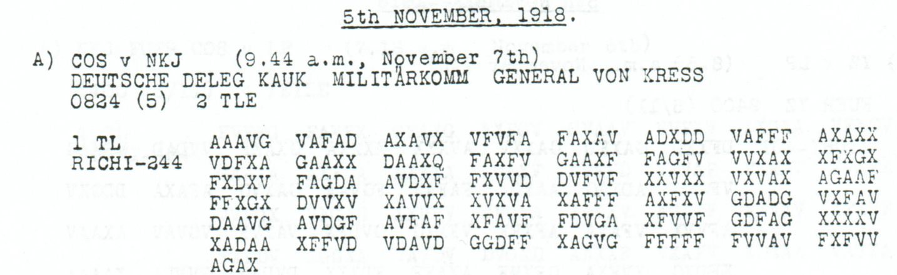
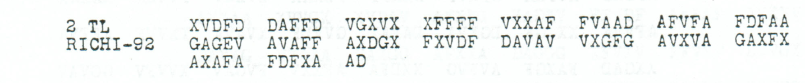

# Childs p136 — readings and source edition

<a id="childs-p-136--readings-and-source-edition"></a>

<!-- Generated by python -m adfgvx.page_editions; edit data/source_editions.json. -->

[Page ranges](README.md) · [By subject](../topics/README.md) · [Historical research](../docs/historical-studies/README.md) · [Reading conventions](../docs/reading-conventions.md) · [← p135](135.md) · [p137 →](137.md)

German readings, English interpretations and source explanations for the **4 ciphertexts** on this printed page.

| Source | State | Subject |
| --- | --- | --- |
| [p136 A1](#source-p136-a1) | READING | Gokieloff sent back to Georgia; instruction not to transmit money |
| [p136 A2](#source-p136-a2) | READING | Gokieloff sent back to Georgia; instruction not to transmit money |
| [p136 B1](#source-p136-b1) | PARTIAL | Silk purchases in the Caucasus; first part |
| [p136 B2](#source-p136-b2) | READING | Resell goods whose transport is not assured |


<a id="edition-cases-people-gokieloff-return-payment-stop"></a>

<a id="p136-a1-p136-a2--gokieloff-sent-back-to-georgia-instruction-not-to-transmit-money"></a>

## Gokieloff sent back to Georgia; instruction not to transmit money

**Sources on this page:** p136 A1, p136 A2.

<a id="edition-cases-people-gokieloff-return-payment-stop-gokieloff-sent-back-to-georgia-instruction-not-to-transmit-money"></a>


<a id="source-p136-a1"></a>
<a id="edition-cases-people-gokieloff-return-payment-stop-p136-a1"></a>

### p136 A1

**Status:** 121/122 native raw positions fixed; 4 coordinate substitutions and 1 source-mask fill. No frame change.

**Source and dates:** Page heading: 5th NOVEMBER, 1918; A) COS v NKJ (9.44 a.m., November 7th); DEUTSCHE DELEG KAUK MILITAERKOMM GENERAL VON KRESS; 0824 (5) 2 TLE; 1 TL RICHI-244.



<details>
<summary>Source and cipher evidence</summary>

**Raw output:**

```text
ZUDORTPAT487LEOXGOKIELOFFXGOKIELOFFX9STWEGENKRAIKHEITVOMMILXGOUVXCZENNTOCHAUMITDDRCHREISESCHEINNAC?GEORGIENZURUECKGESANDTE
```

**Edited output — counted proposal:**

```text
ZUDORTPAT487LEOXGOKIELOFFXGOKIELOFFXISTWEGENKRANKHEITVOMMILXGOUVXCZENNTOCHAUMITDURCHREISESCHEINNACHGEORGIENZURUECKGESANDTX
```

</details>

**Readable German — the same candidate labels with spacing and punctuation:**

> Zu dort PAT487 Leo. Gokieloff, Gokieloff, ist wegen Krankheit vom Mil. Gouv. CZENNTOCHAU mit Durchreiseschein nach Georgien zurueckgesandt.

**Meaning:** The proposed body says the person written Gokieloff was sent back to Georgia because of illness, with a transit permit from the military governor at the literal place CZENNTOCHAU. Both occurrences of the surname are already directly read. The corrected opening reads Zu dort PAT487 Leo; PAT487 remains an opaque reference, and the place spelling is not normalized or mapped to a modern location.

**Conditional interpretation and source details:** The source prints DAAXQ, with a genuine noncoordinate Q at 54. One source-mask fill completes NACH. A separate enlargement resolves XFVVF with a final F, not the initial low-resolution T reading, so it is not counted as an erasure. Four observed-coordinate substitutions separately repair 9ST, KRAIKHEIT and DDRCH, and propose separator X for the final E after GESANDT. 487 and the literal opening and place fields are unchanged.

**Source transcription correction:** The original image reads `XAFFF` at row4/group5, not the earlier `XAFFX` transcription. Correcting source index144 changes raw `ZUPORT` to `ZUDORT` at plaintext position2. This is a correction to the repository transcription, with zero additional historical substitution cost. [Exact previous edition and audit](../experiments/p136_source_glyph_correction/README.md).

<a id="edition-cases-people-gokieloff-return-payment-stop-explicit-source-changes"></a>

#### Explicit source changes

All indices are zero-based.

| Source index | Printed | Proposed | Cost |
| ---: | --- | --- | --- |
| 32 | `F` | `V` | Observed-coordinate substitution |
| 80 | `F` | `V` | Observed-coordinate substitution |
| 158 | `A` | `D` | Observed-coordinate substitution |
| 178 | `V` | `X` | Observed-coordinate substitution |
| 54 | `Q` | `G` | Source-mask fill |

<a id="source-p136-a2"></a>
<a id="edition-cases-people-gokieloff-return-payment-stop-p136-a2"></a>

### p136 A2

**Status:** 45/46 native raw positions fixed; 0 coordinate substitutions and 1 source-mask fill. No frame change.

**Source and dates:** Same A header and page as p136 A1; 2 TL RICHI-92.



<details>
<summary>Source and cipher evidence</summary>

**Raw output:**

```text
KEING?LDUEBERMITTELNXHEERESGRXKIEWX1CXHRW8536X
```

**Edited output — counted proposal:**

```text
KEINGELDUEBERMITTELNXHEERESGRXKIEWX1CXHRW8536X
```

</details>

**Readable German — the same candidate labels with spacing and punctuation:**

> Kein Geld uebermitteln. Heeresgr. Kiew. 1C. HRW8536.

**Meaning:** The second part instructs that no money be transmitted. The closing reads Heeresgr. Kiew, with the literal labels 1C and HRW8536. Those labels are not changed to a presumed staff branch or number prefix.

**Conditional interpretation and source details:** The printed GAGEV contains a clear out-of-alphabet E at source 43. One counted mask fill supplies E in GELD. The result uses the native 92-coordinate frame and no observed-coordinate substitution.

<a id="edition-cases-people-gokieloff-return-payment-stop-explicit-source-changes-1"></a>

#### Explicit source changes

All indices are zero-based.

| Source index | Printed | Proposed | Cost |
| ---: | --- | --- | --- |
| 43 | `E` | `A` | Source-mask fill |

<a id="edition-cases-people-gokieloff-return-payment-stop-reproducibility-and-attribution"></a>

#### Reproducibility and attribution

The [input](../experiments/gokieloff_return_payment_stop/inputs.json) binds each literal source to exact PDF crops. The [certificate](../experiments/gokieloff_return_payment_stop/certificates.json) contains the raw paired-coordinate domains, each source change and the forward checks. The [verifier](../experiments/gokieloff_return_payment_stop/verify.py) checks the unchanged published keys and the live German quotations, retaining all numerical and letter labels.

Source edition and verification: icekylinx and GPT-6 Astra Pro (2026). Childs supplies the historical collection; published reconstruction and key provenance credit Lasry, Niebel, Kopal and Wacker. Earlier repository OCR and body readings are retained in the [attribution record](../experiments/gokieloff_return_payment_stop/prior_candidates.json).


<a id="edition-cases-p152"></a>

<a id="p136-b1-p136-b2--p152--silk-purchases-and-transport-from-the-caucasus"></a>

## p152 — Silk purchases and transport from the Caucasus

**Sources on this page:** p136 B1, p136 B2.

**Related source pages:** [p152](152.md#source-p152), [p152 E2](152.md#source-p152-e2).

<a id="edition-cases-p152-p152--silk-purchases-and-transport-from-the-caucasus"></a>


This order concerns silk bought in the Caucasus and its resale where transport cannot be assured. We identified the truncated p152 challenge with the fuller p136 B transmission and compared its continuation with the independent p144 reception. All use the published **Nov4–6** key.

<a id="source-p136-b1"></a>
<a id="edition-cases-p152-raw-p136-b1-parallel-plaintext"></a>

### Raw p136 B1 parallel plaintext

<details>
<summary>Raw decoded text</summary>

**Raw output:**

```text
FUERKAISERLICHEDEUTSCHEDELEGATIONFUERMAIERHALLERXTIFLISXNUMMERSECHSZEHNVERANLASSELXDGSSIMKAPKKSUSGEKAUFTEXSEIDEXSEIDENGARNEXABFAEHLEXSTRUSENXDETENABTRANSPORT
```

</details>

This direct p136 reading supplies the first-part text absent from the 104-slot p152 fragment. Its word repairs are marked in the readable edition above.

<a id="source-p136-b2"></a>
<a id="edition-cases-p152-raw-continuation-witnesses"></a>

### Raw continuation witnesses

The [p144 A2 continuation](144.md#edition-cases-finance-nov6-silk-resale-continuation) supplies 270 observed coordinates. Its sole proposed change, source index 146 `D` → `A`, repairs `GESTELPT` to the `GESTELLT` already present in p152. Together these receptions give all **135 positions** of the continuation direct paired-coordinate support.

The p144 group `XAFFF` also confirms the `F` supplied in p136's short `XAFF`. The adjacent identical `F`s leave the exact loss position indistinguishable. The p144 edition links its complete source and cipher certificate.

**p136_B2**

<details>
<summary>Raw decoded text</summary>

**Raw output — cross-copy-supported frame including the separately supplied missing F:**

```text
NICHTUNBEDINGTSICHERGESTELLTXISTNACHMOXG9ICHKEITDORTWIEDERVERKAUFTWERDENXMERCATORKRIEGSAMTKRNEGSROHS4OFFQBTEILUNGXRX138XSTRICHXELFXKRAX
```

</details>

**p152_E_part2**

<details>
<summary>Raw decoded text</summary>

**Raw output:**

```text
NICHTPNBEDINGTSICHERGESTELLTXISTNACHMOEGLICHKEITDORTWIODERVERKAUFTWERDENXMERCATORKRIEGMAMTKRIEGSROHSTOFFABTEILUNGXRX138VSTRICHXELF8KRAX
```

</details>

<a id="edition-cases-p152-most-likely-reading"></a>

### Most likely reading

**Readable German — associated witnesses; editorial wording and names remain qualified:**

> Fuer kaiserliche deutsche Delegation, fuer MAIER HALLER, Tiflis. Nummer sechszehn. [Veranlassen, dass] im [Kaukasus] gekaufte Seide, Seidengarne, [Abfaelle], Strusen, [deren] Abtransport nicht unbedingt sichergestellt ist, nach Moeglichkeit dort wieder verkauft werden. Mercator. Kriegsamt, Kriegsrohstoffabteilung. R. 138, Strich, elf. KRA.

**Meaning:** To the Imperial German delegation in Tiflis, for the person or designation written `MAIER HALLER`: arrange for silk, silk yarn, waste and coarse cocoon filaments bought in the Caucasus to be resold locally where their transport cannot be guaranteed. The message is signed Mercator and the War Office's raw materials department.

The reading combines the fuller p136 first part with the continuation witnesses. Brackets mark word repairs; `MAIER HALLER` remains unidentified. The transmitted forms `SECHSZEHN` and `STRICH` are retained. *Strusen* is a historical silk-trade term, described in an [1853 technical account](https://dingler.bbaw.de/articles/ar128114.html).

| Record | Received slots | Header | Review |
| --- | ---: | ---: | --- |
| p152 E, part 1 | 104, including 2 erasures | No length | Damaged tail of the fuller record. |
| p136 B, part 1 | 314 | 304 | Directly decrypts without edits. |
| p136 B, part 2 | 269 | 270 | One missing `F` supplied by p152's parallel group. |
| p152 E, part 2 | 270 | 280 | Directly decrypts with residual garbles. |
| p144 A2 | 270 | 270 | Native continuation; one explicitly supported coordinate substitution. |

<a id="edition-cases-p152-evidence"></a>

### Evidence

At group alignment 210, the fragment and the full record share 88 known symbols, differ at 14, and have 2 erased positions. Restoring the 210-symbol prefix comes from the historical parallel. An exhaustive suffix edit comparison instead has cost 11 and four tied offsets, 211–214, each with 92 known-symbol matches. Neither model establishes a unique historic error sequence.

Three source versions pass exact re-encryption. The complete raw continuation texts, all edits, and both alignment models are in [the certificate](../data/certificates/p152.json). Inspect [p136 B](../sources/excerpts/childs_p136_B.png) and [p152 E](../sources/excerpts/childs_p152_E.png).

The fragment identification and source comparison are by **icekylinx and GPT-6 Astra Pro, 2 November 2026**. This is the first documented identification of that relationship found in our review of the 2017 discussion and 2026 public work. The published period key retains its [original attribution](../data/keys.json).
