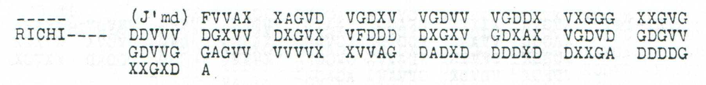

# Childs p163 — readings and source edition

<a id="childs-p-163--readings-and-source-edition"></a>

<!-- Generated by python -m adfgvx.page_editions; edit data/source_editions.json. -->

[Page ranges](README.md) · [By subject](../topics/README.md) · [Historical research](../docs/historical-studies/README.md) · [Reading conventions](../docs/reading-conventions.md) · [← p162](162.md) · [p164 →](164.md)

German readings, English interpretations and source explanations for the **6 ciphertexts** on this printed page.

| Source | State | Subject |
| --- | --- | --- |
| [p163 A13](#source-p163-a13) | READING | Evacuation instructions and a repeated rearguard-position word |
| [p163 A14](#source-p163-a14) | PARTIAL | Final evacuation in one move; retain the Bucharest garrison |
| [p163 A15](#source-p163-a15) | CONDITIONAL | Bucharest garrison transfer and third rearguard-position continuation |
| [p163 A16 (local label)](#source-p163-a16) | CONDITIONAL | Conditional infrastructure clause in an unnumbered jammed continuation |
| [p163 A17](#source-p163-a17) | PARTIAL | Danube vessels and Scholtz headquarters movement to Calimanesti |
| [p163 A18](#source-p163-a18) | PARTIAL | Headquarters moves to Hermannstadt, Kronstadt and Sinaia |

<a id="source-p163-a13"></a>
<a id="source-p163-a14"></a>
<a id="source-p163-a15"></a>
<a id="source-p163-a17"></a>
<a id="source-p163-a18"></a>
<a id="edition-cases-military-p163-a"></a>

<a id="p163-a13-p163-a14-p163-a15-p163-a17-p163-a18--p163-a--withdrawal-instructions-and-headquarters-movements"></a>

## p163 A — Withdrawal instructions and headquarters movements

**Sources on this page:** p163 A13, p163 A14, p163 A15, p163 A17, p163 A18.

<a id="edition-cases-military-p163-a-p163-a--withdrawal-instructions-and-headquarters-movements"></a>


**Status:** Readable fragments of a multipart order, with all proposed repairs
recorded. Parts 13–15 and 17–18 survive; the unnumbered, jammed fragment between
parts 15 and 17 has no established complete frame; a separate conditional
clause is linked below. **Source edition and review:**
icekylinx and GPT-6 Astra Pro. **Period key:** George Lasry and colleagues.

<a id="edition-cases-military-p163-a-most-likely-reading"></a>

### Most likely reading

The message concerns the withdrawal from Romania: keep Crajova and Bukarest
strongly occupied until the last moment, evacuate in one move, retain a
Bucharest garrison, and plan the movements of Scholtz's headquarters and the
army high command. The proposed reading of part 15 joins a sentence across a
part boundary and identifies the garrison's later transfer to Scholtz.

<a id="edition-cases-military-p163-a-parts-1315-evacuation-and-the-bucharest-garrison"></a>

#### Parts 13–15: evacuation and the Bucharest garrison

**Readable German — edited excerpts; absent text remains omitted:**

> … zu erfolgen. Hierbei ist zu beachten, dass Crajova und Bukarest bis zum
> letzten Augenblick stark besetzt — Bukarest 4 Bataillone — bleiben muessen
> und ihre endgueltige Raeumung mit einem Schlage erfolgen muss. Befehl zu
> letzterer erteilt O.K.M. I.R. 204 bleibt zur Besetzung von Bukarest,
> Generalkommando {5/6}3 unterstellt, und wird nach Ankunft in Kronstadt
> O.K. Scholtz zugefuehrt. …

**Meaning:** Crajova and Bucharest are to retain strong garrisons until the last
moment; four battalions are specified for Bucharest. Their final evacuation is
to take place in a single move. The proposed continuation leaves I.R. 204 to
garrison Bucharest, subordinate to Generalkommando {5/6}3, and transfers it to
O.K. Scholtz after reaching Kronstadt.

This passage combines two relatively complete parts with a much less complete
third. Part 13 begins with an unresolved 20-character span. Its received
268 coordinates differ from the printed `RICHI-278` header. No ten-coordinate
restoration is asserted. The reading uses the visible 268-position frame.

Part 15 has 234 printed slots, including two lines of dashes. Only **36/117**
raw plaintext positions are singletons. The proposed 91-position prefix costs
**two substitutions of known coordinates and 63 erasure fills**. Its coherent
wording and the part-14 continuation support the reconstruction; those fills
are not claimed to be uniquely forced. The final 26 positions remain
uncompleted in that earlier prefix edition. Spacing and punctuation in the
quotation are editorial.

A [linked rearguard-position supplement](../experiments/p163_rearguard_continuation/README.md)
now proposes the complete part-15 tail `X7XAUSDER3XNACHHUTSTELLUNG`, giving
“7. Aus der 3. Nachhutstellung …” without supplying the action in the missing
continuation. It retains 33 of the tail's 34 observed coordinates and costs
**one further observed substitution and 18 mask fills**. The complete proposed
part has **116/117 fixed positions**, up from the earlier layer's 98, at totals
of **three substitutions and 81 fills**. Its sole unresolved square digit
remains the coupled `5`/`6` choice. Every newly supplied tail letter has an
observed half; the inherited prefix's wholly absent letter remains identified.

Part 13 independently supports the same `NACHHUTSTELLUNG` sequence at its
opening. The word-only extension adds **three substitutions and two fills**,
retaining raw `ALS3Q`; the separator and the contextual `AUS` preposition
cost one and two more substitutions respectively. The two remaining mask
positions become assigned under each word proposal. Requiring the two spans
to repeat one string leaves **96 joint minimum strings** at four observed
substitutions across their word spans. The military term is a contextual
selection among these, supported by independent historical vocabulary.
`ALS` versus `AUS`, and part 15's equal-price `DER` versus `NUR`, remain explicit
alternatives. The supplementary certificate and exact German displays retain
each layer; the original readings below remain the separately priced baseline.

The [unnumbered jammed continuation now has a separate conditional clause](#edition-cases-military-p163-infrastructure-clause)
concerning the destruction of railways, roads and telephone lines. Its 121
received coordinates are unchanged. The 59-position proposal supplies 65
coordinates in an inferred missing prefix and leaves 84 plaintext positions
unread. Equivalent 284- and 286-coordinate frames, six wholly absent proposed
letters, and the optional unobserved heading `8` remain explicit. This does
not establish the fragment's transmitted length or complete the rest of point 7.

<a id="edition-cases-military-p163-a-parts-1718-danube-boats-and-headquarters"></a>

#### Parts 17–18: Danube boats and headquarters

**Readable German — edited excerpts; absent text remains omitted:**

> … erfolgt noch Befehl. Ebenso betreffend Donauwachtboote und sonstiger
> Schiffsgefaesse. 9. O.K. Scholtz geht voraussichtlich am 13.11. nach
> Calimanesti, spaeter nach Hermannstadt. Generalkommando {5/6}3 am
> 1{5/6}.11. nach Kronstadt. [10.] O.K.M. verbleibt vorlaufig Bukarest,
> verlegt spaeter Hauptquartier nach Sinaia. O.K.M. Ia 11313 op. geh.

**Meaning:** Further orders will follow concerning the Danube guard boats and
other vessels. Scholtz's headquarters is expected to move to Calimanesti on
13 November and later to Hermannstadt. A corps headquarters is to move to
Kronstadt on the stated mid-November date. O.K.M. will initially remain in
Bucharest and later transfer its headquarters to Sinaia.

The two parts contain numerous isolated source garbles. The edition preserves
the unexpanded spelling `VORLAUFIG`; the readable German meaning is
*vorläufig*. The numbered heading `10` is a proposal supported by the preceding
heading `9`: raw position 66 has domain `DEQTUX`, so zero requires a recorded
known-coordinate substitution and an erasure fill. It is not a cipher-only
digit recovery. The original closing reference is garbled; `Ia 11313 op. geh.`
is also part of the explicitly repaired edition.

An [independent AOK 11 map](../experiments/p163_headquarters_map_context/README.md),
CAMO / TsAMO 500-12519-274, places O.K. Scholtz at Calimanesti during the
13–18 November withdrawal interval. This supports the existing one-coordinate
`CA2IMANESTI` → `CALIMANESTI` repair in part 17. It adds no plaintext positions
or repairs and gives no individual date for that headquarters symbol. The
map's separate O.K. Mackensen symbol at Hermannstadt is not evidence that
Scholtz had already reached that town. Both original map details and their
pixel provenance accompany the review.

<a id="edition-cases-military-p163-a-source-and-exact-repair-account"></a>

### Source and exact repair account

Childs, printed p163 / PDF page 166, gives:

<details>
<summary>Literal source transcription</summary>

**Source transcription — clear header and/or literal source record:**

```text
INTERCEPTED BY BRITISH STATIONS.
9th NOVEMBER, 1918.
A) --- v UKS (1.21 a.m., November 9th)
```

</details>

| Source part | Header / visible slots | Raw fixed positions | Proposed known-coordinate substitutions | Proposed erasure fills |
| --- | --- | ---: | ---: | ---: |
| 13 | `RICHI-278` / 268 | 126/134 | 10 | 6 |
| 14 | `RICHI-244` / 244 | 121/122 | 5 | 1 |
| 15 | `RICHI-234` / 234 | 36/117 | 2 | 63 |
| Unnumbered, `J'md` | No surviving length / 121 | No complete frame | — | — |
| 17 | `RICHI-264` / 264 | 125/132 | 16 | 6 |
| 18 | `RICHI-310` / 310 | 131/155 | 21 | 24 |

A fixed raw position can be a historical transmission or copying error. The
third column counts what the given source and key determine, including such
garbles, rather than asserting that every character is correct German.

The complete literal rows, every raw domain, every proposed edit and the
focused source images are in the
[recovery package](../experiments/withdrawal_recovery/README.md).

<a id="edition-cases-military-p163-a-conditional-shared-digits"></a>

### Conditional shared digits

The existing, separately justified
[historical 7–9 November square layer](../experiments/p170_continuation/military_context.json)
assigns `VF=6`, `XA=5`, using the identification of the 6th Reserve Division.
Applying that same layer here gives:

| Field | Cipher-only evidence | Under the existing historical layer |
| --- | --- | --- |
| Part 15 corps | Unchanged `VF` at position 26, domain `56`; next proposed character is `3` | 63 |
| Part 18 corps | Raw `K` at position 40; the edition changes one coordinate to cell `VF` | 63, after that explicit repair |
| Part 18 departure date | Unchanged `XA` at position 46, domain `56` | 15 November |

All positions above are zero-based. The original key remains unchanged.
The numeral inference and the editorial repairs can be accepted separately.
The raw part-17 unknown cell also becomes `6` under the same global assignment;
the readable edition proposes a separator there and records its substitution.

<a id="edition-cases-military-p163-a-raw-plaintexts"></a>

### Raw plaintexts

The question marks below retain source or square uncertainty, and the original
garbles are left untouched.

<details>
<summary>Raw decoded text</summary>

**Raw output — per-part conservative source frames; missing part-15 tail remains unknown:**

```text
13:
ALS3QIA2HHUB?TE?LUNGZUE?F??GEN?HIERBEIISTZUBEACHTENXDASSXCRAJOVAXWNAXBPKARESTBISEI?LETGTEN2UGENBLICKSTARKBE?ETZTXBUKA2EST4XBATANLLONEX

14:
BLEIBENMUESSENUNDIHREENDGUELTIGERAEUMUNGMITEINEMS1HLAGEYFOLGENMUSSXBEFEHLZULETZTERERER9EI?TXOKMXIXRX2C4XBLEIBBZURBESETZUNG

15:
??N?U?A???T?E?E?????M?A?D?????N?T?S?E?????D???D???H?N???F???K?O???A???X?X???O???Z?G???E???X?7???S???3?N???H???B?L???G

17:
ERFOGGTNOCHBEFEHL??BENSOBETR?FFENTDONAUWACHTBOOTJUND?ONSTIGERSCHIF2LGEFAESSEX9XWKXSCHOLT?GEHTVOR2USSICB?L9CHAM13H11XNA?OXCA2IMANESTI

18:
GP2GTERNA2?XHERMANIGTADTXGENERALKOMMANDOK3?A?1??1?HNACHKR?NWTNDTX1?XOKM??ERBLEIBTVORLA?NIGBYKARELTX?ERL?GTSPA?TE?HAUPT??AY?I?RNROHLINA?A?O?MX1II?313OPXGE?X
```

</details>

<a id="edition-cases-military-p163-a-credit-and-reproduction"></a>

### Credit and reproduction

The source intercepts belong to Childs's collection. The period key retains the
earlier Lasry-team credit. This is a new repository source edition and review
by **icekylinx and GPT-6 Astra Pro**, without a first-historical-decipherment
claim. The inspected Lasry–Niebel–Kopal–Wacker author manuscript does not
reproduce these messages.

```sh
python3 experiments/withdrawal_recovery/verify.py --verify
```

This checks independent column arithmetic, the raw and repaired domains,
source-crop hashes, all changes, the separate historical layer and full
re-encryption for the completely determined conditional editions.


<a id="edition-cases-military-p163-infrastructure-clause"></a>

## p163 A16 (local label) — Conditional infrastructure clause in an unnumbered jammed continuation

**Edition context:** p163 A16 — Conditional infrastructure clause in a jammed continuation.

<a id="edition-cases-military-p163-infrastructure-clause-p163-a16--conditional-infrastructure-clause-in-a-jammed-continuation"></a>


**Source review and conditional reconstruction: icekylinx and GPT-6 Astra Pro.**
The unnumbered fragment between parts 15 and 17 permits a partial clause about
the destruction of railways, roads and telephone lines. Its **121 received
coordinates remain unchanged**. The proposed 59-character clause depends on
an inferred missing prefix and supplies 65 absent coordinates; it is a
conditional partial reading, not a complete message or a recovered frame length.

<a id="source-p163-a16"></a>
<a id="edition-cases-military-p163-infrastructure-clause-p163-a16"></a>

### p163 A16

**Readable German — conditional clause in the 286-slot model; the first omission remains unread:**

> […] Wegen Zerstoerung von Eisenbahnen, Strassen und Telephonleitungen …

The following part's earlier edited opening is “erfolgt noch Befehl,” giving
the possible sense: further orders will follow concerning the destruction of
these facilities. This is an order about a future decision, not evidence that
all the listed facilities were destroyed. The continuation is separately
priced: A17 natively reads `ERFOGGTNOCHBEFEHL`, and the prior edition changes
source coordinate 172 from `G` to `D` to obtain `ERFOLGTNOCHBEFEHL`.
Its `NOCHBEFEHL` portion is entirely observed without changes. None of that
inherited repair is counted as a new A16 correction.

<details>
<summary>Raw decoded text</summary>

**Raw output — conditional 286-slot frame with 165 added leading unknown coordinates; unchanged Nov7–9 partial key; 0/143 fixed positions:**

```text
???????????????????????????????????????????????????????????????????????????????????????????????????????????????????????????????????????????????
```

</details>

The received source constrains one half of many letter pairs, even though it
does not fully determine a single plaintext position in this model. The
certificate retains every half-coordinate domain and its received-source owner.

<details>
<summary>Proposed text and exact labels</summary>

**Edited output — proposed clause at positions 84–142; zero observed substitutions, zero printed-mask fills and 65 added-slot fills; 59/143 assigned positions:**

```text
????????????????????????????????????????????????????????????????????????????????????WEGENZERSTOERUNGVONEISENBAHNENXSTRASSENUNDTELEPHONLEITUNGEN
```

</details>

The first **84 plaintext positions** remain unresolved, including the optional
numbered heading. Of the 165 inferred missing coordinates, 100 remain
unassigned in this primary edited stream. No observed coordinate is deleted,
reordered or altered, and none of the 165 added slots is described as a printed
dash. The original only says `J'md` and gives no numerical loss count.

<a id="edition-cases-military-p163-infrastructure-clause-exact-support-and-absent-letters"></a>

### Exact support and absent letters

The 59-position proposal contains **53 observed half-coordinates**, all retained,
and **65 supplied absent halves**. Fifty-three proposed positions retain one
observed half each; the remaining six have neither half observed. Their
zero-based plaintext indices and proposed letters are **92 S, 102 N, 112 E,
122 N, 132 O and 142 N**. These six letters are contextual supplies, not
independently recovered characters.

| Proposed segment | Plaintext positions, inclusive | Observed halves retained | Wholly unobserved positions |
| --- | ---: | ---: | ---: |
| `WEGEN` | 84–88 | 5 | 0 |
| `ZERSTOERUNG` | 89–99 | 10 | 1 |
| `VON` | 100–102 | 2 | 1 |
| `EISENBAHNEN` | 103–113 | 10 | 1 |
| `X` | 114 | 1 | 0 |
| `STRASSEN` | 115–122 | 7 | 1 |
| `UND` | 123–125 | 3 | 0 |
| `TELEPHONLEITUNGEN` | 126–142 | 15 | 2 |

The separate proposal `8X` at 82–83 adds two assigned positions and three
added-slot fills, bringing the optional layer to 61/143. The `8` is wholly
unobserved. Numbered headings 7 and 9 in the neighboring parts motivate it;
they do not turn it into a cipher-only numeral recovery. It is omitted from
the primary edited output above.

<a id="edition-cases-military-p163-infrastructure-clause-two-indistinguishable-frame-models"></a>

### Two indistinguishable frame models

The source retains no part number or transmitted length. `A16` is the local
positional label used by the corpus census, based on its location between
printed parts 15 and 17. It is not transcribed from the fragment's header.

| Conditional frame | Added leading unknown coordinates | Ending proposal | Observed changes | Added-slot fills for the clause |
| --- | ---: | --- | ---: | ---: |
| 286 slots / 143 positions | 165 | `WEGEN…TELEPHONLEITUNGEN` | 0 | 65 |
| 284 slots / 142 positions | 163 | `WEGEN…TELEPHONLEITUNGX` | 0 | 63 |

The two models give **identical native coordinate pairs and identical
received-source ownership at all first 142 plaintext positions**. The
286-slot model adds one wholly unobserved final position. Thus the received
ciphertext cannot distinguish these two lengths. Plural wording is a contextual
choice, not a proof of 286 slots. The shorter model retains the singular noun
and final proposed `X` separator as an explicit alternative.

The proposed connector `UND` also has equal-price alternatives `MIT` and `WIE`
at 123–125. The certificate prices them separately. Their arithmetic
compatibility does not establish equally suitable historical meanings.
No full text is asserted for the unknown opening or for the remainder of
point 7 from the previous part.

<a id="edition-cases-military-p163-infrastructure-clause-source-and-independent-checks"></a>

### Source and independent checks

<details>
<summary>Literal source transcription</summary>

**Source transcription — all 121 received coordinates in printed order; no added prefix is included here:**

```text
FVVAX XAGVD VGDXV VGDVV VGDDX VXGGG XXGVG
DDVVV DGXVV DXGVX VFDDD DXGXV GDXAX VGDVD GDGVV
GDVVG GAGVV VVVVX XVVAG DADXD DDDXD DXXGA DDDDG
XXGXD A
```

</details>

The page labels this fragment `J'md` and `RICHI----`. Its first surviving row
has seven five-coordinate groups; two full rows and the final six coordinates
follow. Treating the jamming mark as missing material before this suffix is an
explicit model. Group alignment can motivate candidate lengths, but cannot
supply a vanished header or prove how many groups were lost.



The [focused package](../experiments/p163_infrastructure_clause/README.md)
rebuilds the source map, both frame models, exact repair prices, unfilled domains,
connector alternatives and optional heading. Independent column arithmetic and
full round trips check both injective assignments of the key's unresolved
`5`/`6` cells. Witness-only fills of other missing coordinates do not enter the
published partial reading. Native messages provide separate vocabulary witnesses
for several component words; they are not copies of this clause.

[Inputs and source identity](../experiments/p163_infrastructure_clause/inputs.json)
· [Per-position certificate](../experiments/p163_infrastructure_clause/certificates.json)
· [Earlier parts and separately priced A17](#edition-cases-military-p163-a)
· [Original PDF, printed p163 / PDF page 166](https://drive.google.com/file/d/1_JiNMck7eUvdrOTrH7fsj1Yh44t-VSC6/view).

**Reproduction:**

```sh
python experiments/p163_infrastructure_clause/verify.py --verify
```

The period key and earlier cryptanalytic work retain the credit to George Lasry,
Ingo Niebel, Nils Kopal and Arno Wacker. The earlier source transcription is
preserved exactly. The new conditional clause, independent audit and source
review are by **icekylinx and GPT-6 Astra Pro**.
