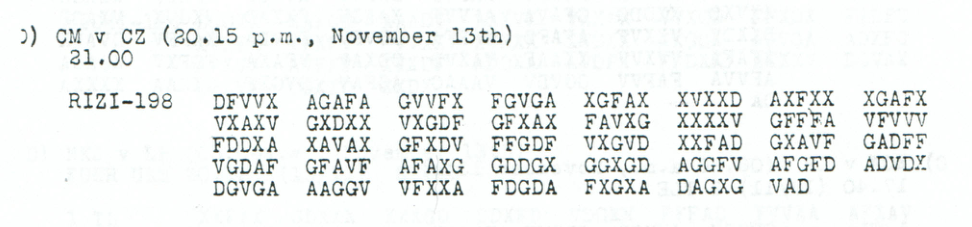
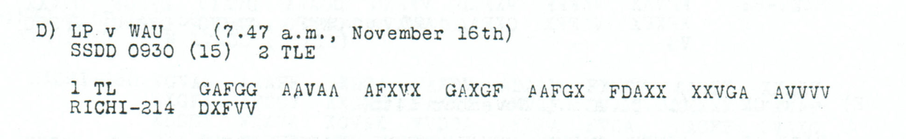

# Childs p194 — readings and source edition

<a id="childs-p-194--readings-and-source-edition"></a>

<!-- Generated by python -m adfgvx.page_editions; edit data/source_editions.json. -->

[Page ranges](README.md) · [By subject](../topics/README.md) · [Historical research](../docs/historical-studies/README.md) · [Reading conventions](../docs/reading-conventions.md) · [← p193](193.md) · [p195 →](195.md)

German readings, English interpretations and source explanations for the **5 ciphertexts** on this printed page.

| Source | State | Subject |
| --- | --- | --- |
| [p194 A](#source-p194-a) | PARTIAL | Arranged departure to Hanau via DHFN |
| [p194 B](#source-p194-b) | PARTIAL | Pilot representative of the Warsaw soldiers’ council arrives in Berlin |
| [p194 C](#source-p194-c) | PARTIAL | Urgent inquiry about Army Group Kiev’s chosen march route |
| [p194 D1](#source-p194-d1) | OPEN | Short first-part fragment from WAU |
| [p194 E](#source-p194-e) | PARTIAL | FRANZ and EMIL control markers for Warsaw soldiers’ council telegrams |


<a id="edition-cases-context-transport"></a>

## p194 A — Arranged departure to Hanau via DHFN

**Edition context:** Transport traffic — p185/p189 and parallel messages.

**Related source pages:** [p185 D](185.md#source-p185-d), [p189 E](189.md#source-p189-e), [p193 E](193.md#source-p193-e), [p196 B](196.md#source-p196-b), [p197 E](197.md#source-p197-e), [p198 C](198.md#source-p198-c).

<a id="edition-cases-context-transport-transport-traffic--p185p189-and-parallel-messages"></a>


**Status: source-preserving partial reading under a plausible, unproved gap geometry.** This supplementary **p185 D** intercept is outside the 22-message challenge. Its header reads `CM v CZ (20.15 p.m., November 13th), 21.00, RIZI-198`, but the body contains 193 slots: 192 valid ADFGVX coordinates and one literal `Y`. The raw `Y` is retained in the source layer and treated as one unknown coordinate in analysis.

**Current transcription, comparison and verification:** icekylinx and GPT-6 Astra Pro. Historical keys and source witnesses retain the provenance recorded in the certificate.

<a id="source-p194-a"></a>
<a id="edition-cases-context-transport-independent-transport-context"></a>

### Independent transport context

Six additional source-checked intercepts decrypt directly with the same historical key. They retain every literal garble and unresolved square cell:

- **p193 E, 14 November:** `KLEINERFEDERWAGENZU?ANHAENGENHIERXKOMMTAUTOX`
- **p194 A, 14 November, header `CM v CZ`:** `ABTRANSPORTINVERABREDETERWEISEFREITCGDHFN1?00XWAGENBERE?THALTENXMARSCHZIELHANAUXSEIFERT`
- **p196 B, 15 November, header `CM v CZ`:** `ABTRANSPORTINVERABREDETERWEISEFREITAGDHFN1?00XWAGENBEREITHALTENXMARSCHZIELHANAUXSEI?ERT`
- **p197 E, 15 November, header `CM v CZ`:** `LASTAUTO1?00A?GEFAHRENXICHBLEIBEMIT?MANNBISSOHNTAGXALLESGUTEAUFWIEDERSEHENXSE?FERTXGRUSSBOCHO`
- **p198 C, 15 November, header `CM v CZ`:** `LASTAUTO1?00ABGEFAHRENXICHBLEIBEMIT?MANNBISSONNTAGXALLESGUTEAUFWIEDERSEHENXSEHFERTXGRUSSBOCHO`
- **p189 E, 15 November, header `CZ v CM`:** `JAHEBEPUMPEAUSBLECHXKOMMEN?AUTOSXHIER?ANH?ENGER`. This is a different intercept from the p189 challenge target.

The p194/p196 pair repeats `DHFN` and names `HANAU` as the march destination. It has 171 of 174 raw coordinates in common; disagreements are at indices 82 (`K/X`), 167 (`X/V`), and 173 (`D/G`). The p197/p198 pair agrees at 183 of 186 coordinates, differing at indices 59 (`V/A`), 63 (`A/V`), and 67 (`G/A`). Neither lorry-message copy supplies an exact `SEIFERT` signature; `SEHFERT` is not silently corrected.

For the transport-order pair, a separately labelled source-supported composite takes `X` at index 82 and `V` at index 167 from p196 while retaining p194's `D` at index 173. It reads:

<details>
<summary>Raw decoded text</summary>

**Raw output — conditional source-supported composite of the p194 and p196 witnesses:**

```text
ABTRANSPORTINVERABREDETERWEISEFREITAGDHFN1?00XWAGENBEREITHALTENXMARSCHZIELHANAUXSEIFERT
```

</details>

This composite fixes 86 of 87 characters. It makes an editorial choice
between disagreeing source witnesses, with every chosen value attested in
at least one. The certificate retains all four combinations of the two
disagreements between valid coordinates. The planned-time cell `FV`
remains unassigned.

Under the separate shared VG=2 interpretation, the reported-hour cell
`AF` cannot also be 2. If the departure occurred on the report's date
before its `13.45` origin time, `1?00` therefore becomes **13:00**. That
chronological assumption is kept separate from the source-supported
composite. The [linked-field comparison](197.md#edition-cases-context-transport-197-198-linked-number-fields)
also shows why this reading cannot be combined with the earlier extra
assumption that the reported departure was no earlier than the planned one.

The [certificate](../data/certificates/p185_D_transport.json) contains every gap geometry, its full plaintext domains, exact source-to-plaintext mapping, all six direct context readings, both near-parallel comparisons, and the conditional composite. The [standalone verifier](../adfgvx/transport.py) recomputes all 194 constraint sets and exact coordinate roundtrips without a language model. It checks the consistency of the stored ranking order but does not recompute the heuristic scores. The [portable ranking script](../experiments/known_key/README.md) reproduces both complete rankings from a pinned upstream model; every stored score matched exactly in the recorded environment.

```sh
python3 -m adfgvx.transport
```

This analysis does not fully solve p189 and does not add a solved item to the 22-message total.

Four [additional p197/p198 witnesses](197.md#edition-cases-context-transport-197-198) now connect the
conversation with equipment for Darmstadt, a lorry, a trailer and a petrol
pump. Their duplicate-group and missing-coordinate hypotheses have separate
source and arithmetic certificates.

Source images: [p189](../sources/excerpts/childs_p189_context.png), [p193](../sources/excerpts/childs_p193_context.png), [p194](../sources/excerpts/childs_p194_context.png), [p196](../sources/excerpts/childs_p196_context.png), [p197](../sources/excerpts/childs_p197_context.png), [p198](../sources/excerpts/childs_p198_context.png). Header order is `recipient v sender`; see [source conventions](../sources/README.md).

<a id="edition-cases-context-transport-most-likely-readings"></a>

### Most likely readings

| Record | Readable German text | Meaning and uncertainty |
| --- | --- | --- |
| p185 D, conditional word completion | […] marschiert Lastautos morgen 1500 ueber DHFN. Abmarschbereit sein. […] Seifert. | The reconstructed clause concerns trucks moving tomorrow via `DHFN` and orders readiness to depart. Three coordinate substitutions and three fills complete the words; the opening and closing instruction remain damaged. |
| p193 E | Kleiner Federwagen zu[m] Anhaengen hier. Kommt Auto. | A small sprung cart for attachment is available; the message mentions a car. Punctuation and the `M` are editorial. |
| p194 A / p196 B composite | Abtransport in verabredeter Weise Freitag DHFN 1?00. Wagen bereithalten. Marschziel Hanau. Seifert. | Departure as arranged on Friday; keep vehicles ready; Hanau is the destination. Every selected coordinate is attested in one of the two witnesses, but one time digit remains unknown. |
| p197 E / p198 C | Lastauto 1?00 abgefahren. Ich bleibe mit ? Mann bis Sonntag. Alles Gute, auf Wiedersehen. [Seifert]. Gruss Bocho. | The truck has departed; the sender remains with an unknown number of men until Sunday. The signature is normalized editorially; neither witness spells it exactly this way. |
| p189 E, conditional shared digit | Ja, Hebepumpe aus Blech. Kommen 2 Autos. Hier 2 Anhaenger. | Two vehicles and two trailers; VG=2 and one invalid-coordinate fill complete the short message. |

Brackets mark editorial interpretations; `?` retains an unresolved character. `DHFN`, `STATMET` and `BOCHO` are not expanded or geographically identified. The exact readings and witness disagreements follow below.

<a id="edition-cases-context-transport-two-vehicles-and-two-trailers--p189-e"></a>

#### Two vehicles and two trailers — p189 E

**Readable German — conditional shared VG=2, with one invalid-coordinate fill:**

> Ja, Hebepumpe aus Blech. Kommen 2 Autos. Hier 2 Anhaenger.

The [award-class interpretation](../experiments/nov13_joint_completion/README.md#the-award-class)
supplies **VG=2** to both count fields, at plaintext positions **26 and 37**.
The word `ANH?ENGER` has the partial pair `V?`, with the invalid printed `B`
at source position **81**. Filling it as **V** gives `ANHAENGER`. This takes
the native 94-slot message from **44 to 47/47** fixed positions: two digits
from the shared square and one ordinary-word fill, with **no observed-coordinate
substitution**. The source's `B` remains visible in the literal transcription.
Indices are zero-based. [Exact completion and source mapping](../experiments/nov13_joint_completion/transport_certificate.json).

<a id="edition-cases-context-transport-conditional-result"></a>

### Conditional result

Inserting five erasures before source index **55**, a printed group boundary, gives this exact partial plaintext:

<details>
<summary>Raw decoded text</summary>

**Raw output — conditional five-coordinate gap before source index 55:**

```text
STATMETXMARSCHIERTLCST?UT?SMORGEN1500UEBERDHFNXAB?A6SCHBE?EITSEIN?VS6GROV?AN?IERE?XBITTEF6EXSEIFERT
```

</details>

Under this geometry, **91 of 99 characters are fixed**. The eight unresolved positions consist of six positions touched by uncertain coordinates and two positions using unassigned square cells. The fixed portions include `MARSCHIERT`, `MORGEN1500UEBERDHFN`, and `SEIFERT`; malformed portions are retained literally. `DHFN` and `STATMET` are not expanded into place or station names.

This is a conditional result. The strongest composite language score selects position 55, but a conventional plaintext quadgram score selects position 57:

| Gap before source index | Composite ranking score | Plaintext quadgram mean |
| ---: | ---: | ---: |
| 55 | 24.910328 | -6.041730 |
| 56 | 22.691041 | -6.070230 |
| 57 | 22.641029 | -5.987314 |

These are heuristic scores, not confidence probabilities. All 194 positions are arithmetically compatible with the received symbols. Positions 159 and 160 produce the same masked ciphertext because the inserted gap can exchange places with the existing unknown `Y` slot. There are 193 distinct masked ciphertexts. No plaintext character is fixed across all 194 geometries. The three leading composite-score candidates share 89 fixed characters, but that selected subset is not a confidence set.

<a id="edition-cases-context-transport-truck-movement-and-readiness"></a>

#### Truck movement and readiness

The [word-completion certificate](../experiments/p185_readiness_completion/README.md)
restores the vehicle noun and readiness instruction within the existing gap-55
frame:

**Readable German — conditional excerpt; the ellipses omit the damaged opening and closing instruction:**

> […] marschiert Lastautos morgen 1500 ueber DHFN. Abmarschbereit sein. […] Seifert.

The wording concerns trucks moving the following day via `DHFN` and instructs
the recipient to be ready to depart. `STATMET`, the transmitted `1500` and the
closing command remain unexpanded in the exact text. The unusual word order
is preserved.

`LCST?UT?S → LASTAUTOS` costs two observed-coordinate substitutions and a fill
of the printed `Y`. `AB?A6SCHBE?EITSEIN → ABMARSCHBEREITSEIN` costs one
substitution and two fills inside the five-coordinate gap. The edition fixes
**95/99 positions**, up from 91; three inserted coordinates remain unknown.
The same conversation has native `LASTAUTO` in p198 C, `ABMARSCH` in p193 C
and `BEREIT` in p196 B. These support the vocabulary without establishing an
identical sentence in another reception.

<details>
<summary>Exact conditional word completion</summary>

**Edited output — gap 55, three observed-coordinate substitutions, one printed-glyph fill and two missing-slot fills:**

```text
STATMETXMARSCHIERTLASTAUTOSMORGEN1500UEBERDHFNXABMARSCHBEREITSEIN?VS6GROV?AN?IERE?XBITTEF6EXSEIFERT
```

</details>

A separate lexical check masks the numerical field, opening designation and
closing instruction. Among all 194 gap positions, **52–55** tie at the minimum
of three observed substitutions. The readable clause therefore remains
conditional on the retained gap-55 frame; the word repairs do not prove its
geometry.

```sh
python experiments/p185_readiness_completion/verify.py --verify
```


<details>
<summary>Comparative source sections from other printed pages</summary>

<a id="edition-cases-context-transport-p185-d-source-and-gap-model"></a>

### p185 D source and gap model



We enumerated all 194 possible positions for a contiguous block of five missing coordinates under the audited 13 November–15b key. Every valid received coordinate remains unchanged and in its original order. No missing coordinate or unknown square cell is filled.

</details>

<a id="source-p194-b"></a>
<a id="edition-cases-radio-nov14-radio-retransmissions"></a>

## p194 B — Pilot representative of the Warsaw soldiers’ council arrives in Berlin

**Edition context:** 14 November cross-key notices: an arriving pilot and a backup radio station.

**Related source pages:** [p190 A](190.md#source-p190-a), [p190 B](190.md#source-p190-b), [p190 D](190.md#source-p190-d), [p190 E](190.md#source-p190-e), [p193 A](193.md#source-p193-a), [p193 B](193.md#source-p193-b).

<a id="edition-cases-radio-nov14-radio-retransmissions-november-14-cross-key-notices-an-arriving-pilot-and-a-backup-radio-station"></a>


**Source edition and cross-key comparison: icekylinx and GPT-6 Astra Pro.**

Seven intercepts on Childs's printed pages 190, 193 and 194 preserve three
message families. Two radio-service requests were sent under different
keys. Two notices about a pilot's arrival in Berlin describe the same
apparent event, with changed wording. A third interrupted arrival notice
matches a complete source exactly: that witness restores **85 missing
coordinates and 85 additional raw plaintext positions** without changing any
of the fragment's 195 received coordinates.

<a id="edition-cases-radio-nov14-radio-retransmissions-which-station-can-replace-nkj"></a>

### Which station can replace NKJ?

The p190 B and p190 E messages read, with the separately certified repairs:

**Readable German:**

> Welche Station kann NKJ bei Betriebsstoerung vertreten? Vielleicht
> [Sewastopol]. Dring[end] Bescheid an LP.

**Display notes:** `[Sewastopol]` marks a coordinate-priced word proposal; `Dring[end]` expands the literal abbreviation and supplies prose letters only. Neither bracket form by itself asserts direct source support.

**Meaning:** Which station can replace NKJ during an interruption of service?
Perhaps Sevastopol; send an urgent reply to LP. The full city spelling
`SEWASTOPOL` is the candidate reading, and its S is an editorial repair.
The source abbreviation `DRING` is retained in the exact template; the
expanded word above is explanatory.

<details>
<summary>Proposed text and exact labels</summary>

**Edited output:**

```text
WELCHESTATIONKANNNKJBEIBETRIEBSSTOERUNGVERTRETENXXVIELLEICHTSEWASTOPOLXDRINGBESCHEIDANLP
```

</details>

Both ciphertexts have 176 source slots, giving 88 plaintext positions. Their
published keys have different transposition widths: 16 columns for p190 B
and 20 for p190 E. This is an aligned re-encryption comparison, not simply
another message about the same subject.

The literal source decryptions are:

| Source | Unmodified published-key decryption |
| --- | --- |
| p190 B | `WELC?ESTATIO?KANNNKJ?EIBETRI?BSSTOERUNGVERTRETENXXVIELLEICHTSEWAVTOP?LXDRINPBESE?IIDANLP` |
| p190 E | `WELCHE?TATION?ANNNKJBEIBETRIEBSTTOERUNG?ERTRETENXXVIELLEICHTSEWA?TOPOLXDRINGB?SCHEI?ANLP` |

**87/88 preferred positions have a complete pair in at least one source.**
The exception is the S at plaintext index 64 in `SEWASTOPOL`. The earlier
copy has raw V; the other copy has a damaged half-pair whose domain includes
S. The city reading remains a separately priced editorial choice.

The p190 B candidate costs five observed-coordinate substitutions and five
fills for a printed `-----` group. The p190 E candidate costs one
observed-coordinate substitution and six uncertain-slot fills. One of those
six slots is a visible A/X overstrike: the certificate preserves and decrypts
both readings, and the candidate's X is among them. The invalid printed
letters Q and T are also retained in the literal transcription.

<a id="edition-cases-radio-nov14-radio-retransmissions-does-nkj-relay-messages-for-mackensen"></a>

### Does NKJ relay messages for Mackensen?

The p190 D and p193 A notices have the following source-supported reading:

**Readable German:**

> Vermittelt NKJ Funksprueche fuer Mackensen? Habt ihr Verbindung, und wie?
> Dring[end] Bescheid an FUGROSTA. LP.

**Display notes:** `Dring[end]` is the same prose-only abbreviation expansion here. The two witnesses retain their distinct `FUR` and `FUER` spellings in the exact outputs below.

**Meaning:** Is NKJ relaying radio messages for Mackensen? Do you have
contact, and how? Send an urgent reply to FUGROSTA; signed LP. `FUGROSTA`
is retained as transmitted. The transmitted abbreviation is `DRING`.

The longer exact candidate is:

<details>
<summary>Proposed text and exact labels</summary>

**Edited output:**

```text
VERMITTELTXXNKJXXFUNKSPRUECHEFUERMACKENSENHABTIHRVERBINDUNGUNDWIEXXDRINGBESCHEIDANFUGROSTAXXLP
```

</details>

The p190 D text uses `FUR`, giving 93 characters and 186 ciphertext
coordinates. The p193 A text uses `FUER`, giving 94 characters and 188
coordinates. After this one explicitly identified wording difference is
aligned, **every letter of the 94-character candidate has a complete pair
in at least one original source**. Neither ciphertext is padded or trimmed
to make their lengths agree.

The literal decryptions are:

<details>
<summary>Raw decoded text</summary>

**Raw output — separate literal witnesses under their stated period keys:**

```text
p190 D:
VERMITTELTXXNKJXXFUNKSPRUECHEFURMACKENSENHABTIHRV?RBINDUNOUNDWIEXXDRINGBESCHEIDANFUGROSTAXXLP

p193 A:
LERMITTE?T0XDKRX5FUNKS0RUECHZF?ERMACTENSENHA?TIHRVERBINDUNGUNDWIEXXDRINGBE5CIE?DANFU?R0STA?XLP
```

</details>

The p190 D candidate requires two observed-coordinate substitutions. The
p193 A candidate requires 15 substitutions and three fills for printed
dashes. Their full candidate reencryption checks are separate. The large
number of garbles in p193 A does not obscure the independent support from
the cleaner p190 D copy, while p193 A supplies the latter's damaged E and G
in `VERBINDUNG` and the extra E in `FUER`.

<a id="edition-cases-radio-nov14-radio-retransmissions-a-warsaw-soldiers-council-representative-reaches-berlin"></a>

### A Warsaw soldiers' council representative reaches Berlin

The p190 A and p194 B notices say, with their certified ordinary-word repairs:

**Readable German:**

> Zitadelle [Warschau], fuer Soldatenrat. Flieger / Flugzeugfuehrer
> FR?E, Bevollmaechtigter [des] Soldatenrats, in Berlin wohlbehalten
> eingetroffen. Auswaertiges Amt.

**Display notes:** This is a composite readable presentation, not a third recovered source. `[Warschau]` is present in the fuller p194 B witness; `[des]` is supplied grammar absent from both exact wordings. The slash in `Flieger / Flugzeugfuehrer` displays the two witnesses' different words. `FR?E` retains one unresolved name position and is not a proposed surname.

**Meaning:** To the citadel's soldiers' council: the pilot FR?E, a council
representative, has arrived safely in Berlin. The fuller p194 B wording
explicitly includes Warsaw. The raw texts omit the grammatical article
inserted in brackets above. No personal identity is assigned.

The literal decryptions are:

<details>
<summary>Raw decoded text</summary>

**Raw output — separate literal witnesses under their stated period keys:**

```text
p190 A:
ZITADELLEXFUERSOLDATENRXTXXFLIEGERMFR?EXBEVOLLMAECHTIGTERSOLDATENRATSINBERLINWOHLBEHALTENEINGETROFFENXXAUSWAERTCGESAMT

p194 B:
ZITADELLEXWARSCHAUXFUERXSOLDATENRATXFLUGZEUGFUEHRERXFR?EXBEVOLLMAECHTIGTERXSOLDLTENRATSXINXBERLINXWOHLBEHALTENXEINGETROFFENXAUSWAERTIGESAMTX
```

</details>

The p190 A readable template changes three source coordinates to obtain
`RAT`, the separator after `FLIEGER`, and `AUSWAERTIGES`. The p194 B template
changes one coordinate to obtain `SOLDATENRATS`. Both name fields remain
`FR?E`. These notices share a long message body but differ in their opening
words, separators and length; no whole-message ciphertext alignment is used.

<a id="edition-cases-radio-nov14-radio-retransmissions-the-interrupted-p193-b-copy"></a>

#### The interrupted p193 B copy

The p193 B record is headed `WAU v LP (4.15 p.m., November 14th)` and
`RICHI---`, with 195 printed coordinates. All 195 are identical to the suffix
of p194 B beginning at ciphertext index 85. The complete p194 B record has
the same call signs, a `4.14 p.m.` interception time and a `RICHI-280` length.

The certificate first retains the fragment as a 280-position source model
with **85 unknown prefix slots**, which fixes only **54/140 raw positions**.
It then fills those 85 positions from the independently printed beginning
of p194 B. No received coordinate of p193 B is changed. The restored stream
equals p194 B exactly and fixes **139/140 raw positions**: **85 additional
positions** are recovered from the overlapping source, with an exact witness
index for every supplied coordinate.

This restoration preserves the complete copy's literal `SOLDLTENRATS`
garble and its unresolved name cell. The separate A-for-L word repair is
not passed off as part of the observed missing prefix. The 195-coordinate
fragment, its odd length and its unknown printed length label are all
retained in the input record.

<a id="edition-cases-radio-nov14-radio-retransmissions-what-the-shared-surname-does-and-does-not-constrain"></a>

#### Shared-surname constraints and remaining domains

| Witness | Key | Unknown name position | Square cell | Original symbol domain |
| --- | --- | ---: | --- | --- |
| p190 A | Nov13–15b | 37 | FX | 234789QY |
| p194 B | Nov13–15a | 54 | DG | 0123456789QY |

Indices are zero-based. If both fields contain the same correctly copied
name, the two cells must represent the same symbol, with intersection
**234789QY**. This eliminates four possible assignments from the second
field, but does not identify the symbol. A further letter-only assumption
leaves **Q or Y**.

`FRYE` is a plausible surname proposal. It is not uniquely established by
the domain intersection, and no independent historical identification has
been found. The certificate checks all eight common symbols: each one
reencrypts the edited templates exactly under the corresponding conditional
cell assignments. Accordingly neither published square is filled.

<details>
<summary>An archival lead for the unresolved pilot name</summary>

The council's own *Mitteilungsblatt des Deutschen Soldatenrates Warschau*
is a concrete source to inspect. The [official ZDB record](https://zdb-katalog.de/title.xhtml?idn=989924653)
catalogues issues 1–5, dated 12–17 November 1918, with an explicit uncertainty
marker. It locates holdings at the Bayerische Staatsbibliothek in Munich
(**Rar. 1323**) and the Wuerttembergische Landesbibliothek in Stuttgart
(**ZCa 82170**). The latter records issues 1, 2, 4 and 5. The
[catalogue review](../data/reviews/warsaw_pilot_bulletin_lead.json)
preserves the exact date strings and identifiers. No bulletin text or page
image has been inspected, so this locator supplies no evidence identifying
`FR?E` and does not settle either unknown square cell.

</details>

<a id="edition-cases-radio-nov14-radio-retransmissions-evidence-and-exact-reproduction"></a>

### Evidence and exact reproduction

- [Source inputs, headers and published keys](../experiments/nov14_retransmissions/inputs.json)
- [Per-letter coordinate domains and repair certificates](../experiments/nov14_retransmissions/certificates.json)
- [p190 A source](../experiments/nov14_retransmissions/sources/p190_A.png)
- [p190 B source](../experiments/nov14_retransmissions/sources/p190_B.png)
- [p190 D source](../experiments/nov14_retransmissions/sources/p190_D.png)
- [p190 E source](../experiments/nov14_retransmissions/sources/p190_E.png)
- [p193 A source](../experiments/nov14_retransmissions/sources/p193_A.png)
- [p193 B source](../experiments/nov14_retransmissions/sources/p193_B.png)
- [p194 B source](../experiments/nov14_retransmissions/sources/p194_B.png)
- [Experiment and verification instructions](../experiments/nov14_retransmissions/README.md)

The seven records contain **1,437 printed source slots**. Their declared
frames fix **654/761 raw positions** before filling the interrupted prefix,
or **739/761** after the independent witness supplies it. The denominator
includes p193 B's explicitly restored 280-coordinate frame. Fixed positions
include literal garbles; they are not all claimed as correct historical
letters. Published keys are credited in the input provenance. This edition
provides source review and exact comparison, without a claim to first
decipherment of every underlying text.

<a id="source-p194-c"></a>
<a id="source-p194-e"></a>
<a id="edition-cases-radio-warsaw-service-messages"></a>

<a id="p194-c-p194-e--warsaw-control-markers-and-radio-forwarding-instructions"></a>

## Warsaw control markers and radio forwarding instructions

**Sources on this page:** p194 C, p194 E.

**Related source pages:** [p192 A](192.md#source-p192-a), [p192 B](192.md#source-p192-b).

<a id="edition-cases-radio-warsaw-service-messages-warsaw-control-markers-and-radio-forwarding-instructions"></a>


**ADFGVX Cipher — icekylinx and GPT-6 Astra Pro**

Four previously uncatalogued messages can be read with the published
`Nov13-15b` partial square. They describe commercial reporting from Bucharest,
LP's forwarding responsibilities, Army Group Kiev's march route, and the
`FRANZ`/`EMIL` markers used for Warsaw messages. The physical source, unresolved
symbols and exact price of each proposed repair are retained separately.

Primary evidence: J. Rives Childs, *General Solution of the ADFGVX Cipher
System*, printed pp192 and 194 (PDF page 195 and 197). The corresponding crops,
PDF hash and literal transcriptions are in
[the source edition](../experiments/warsaw_service_messages/inputs.json).
The published square's unknown cells and numerical labels are not changed.

<a id="edition-cases-radio-warsaw-service-messages-p194-c-which-march-route-will-army-group-kiev-choose"></a>

### p194 C: which march route will Army Group Kiev choose?

The header is `IWE v WAU (2.31 a.m., November 16th)`, origin `2300 (15)`,
`RICHI-224`. All 224 printed coordinates are valid.

Raw reading, 111 fixed positions out of 112:

<details>
<summary>Raw decoded text</summary>

**Raw output:**

```text
HEERESGRUPPEXKIEWXXWELCHENC?MARSCNWEGWAEHLTUEERESGRUPPEKIEWXXDRINGENDBALDIGSTBESCHEIDFUNKENXPRESSEXSXRXWARSCHAUX
```

</details>

Changing source index 5 from `X` to `A`, and source index 60 from `V` to `A`,
restores the two clear ordinary words:

<details>
<summary>Proposed text and exact labels</summary>

**Edited output:**

```text
HEERESGRUPPEXKIEWXXWELCHENC?MARSCHWEGWAEHLTHEERESGRUPPEKIEWXXDRINGENDBALDIGSTBESCHEIDFUNKENXPRESSEXSXRXWARSCHAUX
```

</details>

The message asks which march route the army group will choose, requesting an
urgent prompt reply by radio, and ends with the Warsaw soldiers' council's
press designation. The `C?` segment after `WELCHEN` is still unexplained.
Reading it as `XX` would require **three additional observed-coordinate
changes**; that complete but editorial candidate is priced separately in the
certificate and is not promoted to the conservative raw text.

<a id="edition-cases-radio-warsaw-service-messages-p194-e-franz-and-emil-control-markers"></a>

### p194 E: FRANZ and EMIL control markers

The source is `LP v WAU (---- November 16th)`, `SSDD 2256 (15)`,
`RICHI-240`. Its first group is literally `XFYGF`, so the `Y` at source
index 2 is treated as an erasure. The other 239 coordinates are valid.

Raw reading, 119 fixed positions out of 120:

<details>
<summary>Raw decoded text</summary>

**Raw output:**

```text
ZUKUENFTIGWERDENUNK?NTOLLIERTETELSDESXSXRXWARSCHAUDURCHXXFRANZXXXKONTROLLIERTEDURCHXXEMILXXGEKENNZEICHNETXXSXRXWARSCHAUX
```

</details>

Filling the invalid coordinate as `X` yields this complete, exactly
reencryptable candidate without changing any valid source coordinate:

<details>
<summary>Proposed text and exact labels</summary>

**Edited output:**

```text
ZUKUENFTIGWERDENUNKONTOLLIERTETELSDESXSXRXWARSCHAUDURCHXXFRANZXXXKONTROLLIERTEDURCHXXEMILXXGEKENNZEICHNETXXSXRXWARSCHAUX
```

</details>

Future unchecked telegrams from the Warsaw soldiers' council are to be marked
`FRANZ`; checked telegrams are to be marked `EMIL`. The source plaintext spells
the first adjective **UNKONTOLLIERTE**, omitting the expected `R` from the
ordinary German word. It also puts three `X` separators after `FRANZ`. Neither
irregularity is silently changed to make the sentence look cleaner.

<a id="edition-cases-radio-warsaw-service-messages-reproducibility-and-limits"></a>

### Reproducibility and limits

The [verifier](../experiments/warsaw_service_messages/verify.py) checks the
published key against `data/keys.json`, independently rebuilds the
transposition indices, records every plaintext domain, reconstructs every
candidate ciphertext from its listed edits, and exhaustively retains the two
p192 B gap minima. Its optional PDF check verifies source-crop pixels.

The four records contain 1,081 literal slots, of which 1,079 are valid
coordinates. After the one declared insertion, their models have 541 plaintext
positions, 532 fixed before repair and 535 in the conservative candidates.
The shared VG=2 interpretation adds **two** reference digits, reaching
**537/541**, as checked in the
[shared-traffic certificate](../experiments/nov13_joint_completion/traffic_certificates.json).
The remaining reference symbols, the published `0` and `5`, and the
inconsistent source dates are retained.


<details>
<summary>Comparative source sections from other printed pages</summary>

<a id="edition-cases-radio-warsaw-service-messages-p192-a-request-to-kretzschmar-in-bucharest"></a>

### p192 A: request to Kretzschmar in Bucharest

The source header is `NKJ FUER UKS`, receipt `06.45 p.m., November 14th`,
origin `22.55 (15/11)`, and `RICHI-350`. The incompatible dates are preserved.
The 350 printed slots include an `E`-like overstrike at source index 120,
inside the group `EXAXF`. It is outside the six-coordinate alphabet and is
treated as an erasure.

Raw decryption, 171 fixed positions out of 175:

<details>
<summary>Raw decoded text</summary>

**Raw output:**

```text
ANXOBLT0KRETZSCHMARBEIXOKMXWIRTSCHAFTSSTABABTX1XBUKARESTXNRX???XERBITTENNACHRICHTUEBERLAGENUN?AUSSICHTENSOWIEBEZUEGLICHUNSERERINTERESSENGEFASSTEBESCHLUESSEXDEUTKAUF5AUSWAERTIG
```

</details>

Filling that overstrike as `F` restores `UND`, with no change to an observed
valid coordinate:

<details>
<summary>Proposed text and exact labels</summary>

**Edited output:**

```text
ANXOBLT0KRETZSCHMARBEIXOKMXWIRTSCHAFTSSTABABTX1XBUKARESTXNRX???XERBITTENNACHRICHTUEBERLAGENUNDAUSSICHTENSOWIEBEZUEGLICHUNSERERINTERESSENGEFASSTEBESCHLUESSEXDEUTKAUF5AUSWAERTIG
```

</details>

The message asks Oberleutnant Kretzschmar, attached to the OKM economic staff,
department 1, in Bucharest for news about the situation and prospects, and
decisions affecting the sender's interests. The literal forms `OBLT0`,
`LAGEN`, and `DEUTKAUF5` are not normalized inside the ciphertext model.
The three reference symbols after `NRX` occupy cells `VG`, `AF`, `AF`.
The [shared conditional VG=2 reading](../experiments/nov13_joint_completion/README.md#the-award-class)
gives **`2??`**, with the two unknowns still equal. This adds one label to the
existing edition, reaching **173/175**, without another source edit.

<a id="edition-cases-radio-warsaw-service-messages-p192-b-lp-relays-traffic-in-both-directions"></a>

### p192 B: LP relays traffic in both directions

The header reads `NKJ v LP (06.56 p.m., November 14th)` and
`NKJ FUER ZO'N 17.30 (15/11)`. Although it advertises `RICHI-268`, the source
has **267** coordinate letters: the 22nd printed group is only `FVGA`.

Inserting one unknown coordinate immediately after that group gives this raw
reading, with 131 fixed positions out of 134:

<details>
<summary>Raw decoded text</summary>

**Raw output — conditional insertion immediately after the short printed group:**

```text
KWHXLPXUEBERMITTELTALLEVORLIEGENDENWICHTIGENNACHRICHTENFUERHEIMATDIENSTSTE?LENSOWIEXOHLXUNDUMGEKEHRTXKMXALLGXKRIEGSDEPXNRX?5?1115XANCH
```

</details>

The ordinary-word candidate is:

<details>
<summary>Proposed text and exact labels</summary>

**Edited output — same conditional missing-slot frame, with the stated repairs:**

```text
KWHXLPXUEBERMITTELTALLEVORLIEGENDENWICHTIGENNACHRICHTENFUERHEIMATDIENSTSTELLENSOWIEXOHLXUNDUMGEKEHRTXKMXALLGXKRIEGSDEPXNRX?5?1115XANCH
```

</details>

Its meaning is direct: LP transmits all available important messages for home
offices and OHL, and conversely. The ending names `KM`, the general war
department and a reference that remains literally `?5?1115` under the
published partial square.

An exhaustive check of all 268 possible insertion boundaries finds exactly
two zero-substitution fits to that ordinary-word stencil: source gaps **109**
and **110**. Both insert `F` next to the same observed `F`, producing the same
repaired ciphertext. The alternative unfilled gap moves the single erased
plaintext letter from `DIENSTSTE?LEN` to `SOWI?`; both complete to the same
candidate. No other source coordinate is altered. The two baseline unknown
reference symbols are at cells `GD` and `VG`. Applying the shared conditional
VG=2 assignment gives **`?521115`**, taking this edition to **133/134** fixed
labels; GD remains unknown. Both gap alternatives are retained.

</details>

<a id="source-p194-d1"></a>
<a id="edition-cases-open-p194-d1"></a>

## p194 D1 — Short first-part fragment from WAU

**Edition context:** p194 D1 — Short first-part fragment from WAU.

<a id="edition-cases-open-p194-d1-p194-d1--short-first-part-fragment-from-wau"></a>


**State: OPEN.** Source transcription and review: **icekylinx and GPT-6 Astra Pro**.

Only 45 observed coordinates survive for a first part advertised as `RICHI-214`. No body reading is accepted. The numerical shortfall is visible source evidence; the absent coordinates are not printed erasures.

<a id="edition-cases-open-p194-d1-source"></a>

### Source



<details>
<summary>Source and cipher evidence</summary>

**Source transcription — clear header, spacing normalized from the source:**

```text
D) LP v WAU (7.47 a.m., November 16th)
SSDD 0930 (15)   2 TLE
1 TL
RICHI-214
```

**Source transcription — literal ciphertext, printed row and group boundaries retained:**

```text
GAFGG AAVAA AFXVX GAXGF AAFGX FDAXX XXVGA AVVVV
DXFVV
```

</details>

| Evidence | Count |
| --- | ---: |
| Received source slots | 45 |
| Observed ADFGVX coordinates | 45 |
| Printed erasure slots | 0 |
| Advertised part length | 214 |

<a id="edition-cases-open-p194-d1-boundaries-and-uncertainty"></a>

### Boundaries and uncertainty

The reception header says November 16th at 7.47 a.m.; the origin line
contains `0930 (15)`. The distinct origin and reception dates are retained.
`1 TL` and `2 TLE` identify a first part within a two-part transmission.

The received body consists of nine full five-coordinate groups, with
`DXFVV` on the second line. There are no printed mask slots. If the advertised
214-coordinate length describes this part, **169 coordinates are absent
from the surviving source**. No guessed tail is appended to the literal
transcription, and 214 is not used as a settled decryption frame.

A short transmitted prefix, a partial copy and a misrecorded length remain
different possibilities. The source alone does not identify the missing
portion or the encrypted subject.

<a id="edition-cases-open-p194-d1-research-leads"></a>

### Research leads

- Search the WAU/LP route and origin line `SSDD 0930 (15)` for another reception, allowing the printed transmission and reception dates to differ.
- Compare the `Nov13-15a`, `Nov13-15b` and `Nov16-18` keys as dated leads. A key choice must be supported by coordinates rather than selected solely from the reception date.
- For any advertised-length model, retain all 45 observed coordinates and report the placement and number of all added unknowns. Short coherent word fits must be checked against equally sparse controls.

These are research directions, not accepted decipherments. A failed search
under one key or loss model does not exclude other source-supported models.

<a id="edition-cases-open-p194-d1-evidence-and-reproduction"></a>

### Evidence and reproduction

The [machine-readable source record](../experiments/open_source_records/inputs.json)
retains the original audit metadata, exact source rows, annotation positions
and crop recipe. The [source-only verifier](../experiments/open_source_records/verify.py)
checks the case transcription, literal digest, native counts and crop pixels;
it produces no plaintext certificate. The [21-source audit](../docs/source-gap-audit.md)
records the earlier boundary review.

```sh
python experiments/open_source_records/verify.py
python experiments/open_source_records/verify.py --pdf /path/to/childs.pdf
```

Source: J. Rives Childs, *General Solution of the ADFGVX Cipher System*,
printed p194, PDF page 197 in the
[scanned volume](https://drive.google.com/file/d/1_JiNMck7eUvdrOTrH7fsj1Yh44t-VSC6/view).
The optional PDF check verifies the original file and reproduces the published crop.
